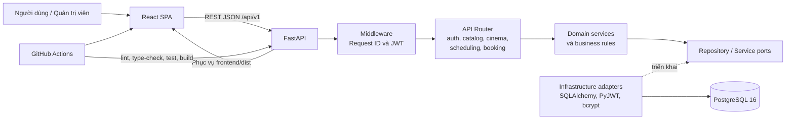
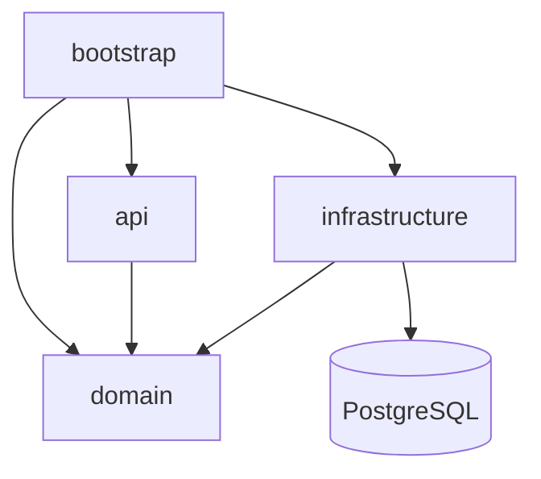
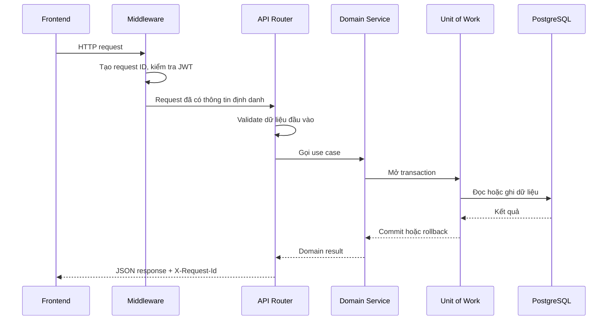

# Tổng quan kiến trúc hệ thống

## 1. Mục tiêu hệ thống

Hệ thống hỗ trợ quy trình đặt vé xem phim cho một rạp, gồm các chức năng chính:

- Khách xem danh sách phim, lịch chiếu và sơ đồ ghế.
- Người dùng đăng ký, đăng nhập, giữ ghế, xác nhận hoặc hủy đặt vé.
- Người dùng xem danh sách vé của chính mình.
- Quản trị viên quản lý phim, phòng chiếu, ghế, suất chiếu và tài khoản.
- Hệ thống bảo đảm một ghế không bị bán cho nhiều người trong cùng một suất chiếu.

Ứng dụng được xây dựng theo mô hình **modular monolith**: frontend và backend nằm trong
cùng repository, backend phục vụ cả REST API lẫn bản build của frontend. Các module nghiệp
vụ được tách rõ ràng nhưng vẫn được triển khai thành một ứng dụng duy nhất.

## 2. Sơ đồ tổng thể



### Luồng phụ thuộc



Chiều phụ thuộc quan trọng nhất là `domain` không phụ thuộc FastAPI, Pydantic, SQLAlchemy
hoặc PostgreSQL. Nhờ đó, quy tắc nghiệp vụ có thể được kiểm thử độc lập với web framework
và cơ sở dữ liệu.

## 3. Cấu trúc repository

```text
INT3105/
├── app/                    Backend FastAPI
│   ├── api/                HTTP router, schema, middleware và xử lý lỗi
│   ├── domain/             Mô hình và quy tắc nghiệp vụ
│   ├── infrastructure/     Database, bảo mật và adapter bên ngoài
│   ├── bootstrap/          Cấu hình và lắp ráp ứng dụng
│   └── main.py             Điểm khởi động ASGI
├── frontend/               React SPA viết bằng TypeScript
│   └── src/
│       ├── app/            App shell và layout chung
│       ├── components/     Thành phần giao diện dùng chung
│       ├── lib/            API client và tiện ích
│       ├── pages/          Các trang của ứng dụng
│       └── styles/         Design token và CSS toàn cục
├── tests/                  Kiểm thử backend
├── docs/                   Đặc tả, kiến trúc, API và kế hoạch dự án
├── deploy/                 Cấu hình triển khai
├── scripts/                Script migration, seed, smoke test và benchmark
└── .github/                CI và mẫu pull request
```

## 4. Nhiệm vụ của từng phần

| Phần | Nhiệm vụ và chức năng |
|---|---|
| `frontend` | Hiển thị giao diện, điều hướng trang, quản lý trạng thái phía client, gọi REST API và trình bày loading/error/empty state. Frontend không tự quyết định trạng thái ghế hoặc giá vé cuối cùng. |
| `app.api` | Tiếp nhận HTTP request, kiểm tra dữ liệu đầu vào, gọi domain service và chuyển kết quả thành JSON response. Đây cũng là nơi ánh xạ lỗi nghiệp vụ thành HTTP status và error code thống nhất. |
| `app.domain` | Chứa entity, value object, use case và toàn bộ quy tắc nghiệp vụ như quyền sở hữu booking, giới hạn số ghế, vòng đời giữ ghế và điều kiện xác nhận/hủy vé. |
| `app.infrastructure` | Cài đặt các port của domain bằng công nghệ cụ thể: SQLAlchemy/PostgreSQL, JWT, bcrypt, database clock và Unit of Work. |
| `app.bootstrap` | Đọc biến môi trường, khởi tạo ứng dụng, đăng ký router/middleware/error handler và lắp các implementation vào service. |
| PostgreSQL | Lưu dữ liệu người dùng, phim, phòng, ghế, suất chiếu, booking và inventory ghế. Constraint và transaction là lớp bảo vệ cuối cùng chống đặt trùng ghế. |
| `tests` | Kiểm tra endpoint, quy tắc nghiệp vụ, tích hợp PostgreSQL và các tình huống tranh chấp đồng thời. |
| CI/CD | Tự động chạy lint, type-check, import-linter, test và build để ngăn mã lỗi hoặc vi phạm kiến trúc được hợp nhất. |

## 5. Các module nghiệp vụ

| Module | Trách nhiệm chính |
|---|---|
| `auth` | Đăng ký, đăng nhập, phát và kiểm tra JWT, lấy thông tin người dùng hiện tại và kiểm soát quyền CUSTOMER/ADMIN. |
| `catalog` | Cung cấp danh sách và chi tiết phim cho người dùng. |
| `cinema` | Quản lý phòng chiếu, sơ đồ ghế, hàng ghế và loại ghế STANDARD/VIP. |
| `scheduling` | Quản lý suất chiếu, thời gian bắt đầu/kết thúc, giá vé và kiểm tra trùng lịch phòng. |
| `booking` | Giữ ghế, xác nhận, hủy, xem booking và xử lý thời hạn giữ ghế. Đây là module có yêu cầu transaction và đồng thời cao nhất. |
| `health` | Cung cấp endpoint kiểm tra tiến trình và trạng thái sẵn sàng của ứng dụng. |
| `common` | Chứa các thành phần HTTP dùng chung như request ID, phân trang và error response. |

## 6. Luồng xử lý một request



Đối với đường đọc, service chỉ truy vấn và trả dữ liệu. Đối với đường ghi như giữ ghế,
xác nhận hoặc hủy booking, toàn bộ use case phải nằm trong một transaction duy nhất.

## 7. Luồng đặt vé cốt lõi

1. Người dùng chọn một suất chiếu và từ 1 đến 8 ghế.
2. Backend kiểm tra suất chiếu còn hợp lệ và các ghế thuộc đúng phòng.
3. Các ghế được sắp xếp theo ID và khóa trong PostgreSQL để giảm nguy cơ deadlock.
4. Backend tạo booking ở trạng thái `HELD` và giữ ghế trong thời gian cấu hình.
5. Khi xác nhận, booking chuyển sang `CONFIRMED` và ghế chuyển sang trạng thái đã đặt.
6. Khi hủy hoặc hết hạn, ghế được trả về trạng thái có thể đặt lại.
7. Constraint và transaction trong database bảo đảm chỉ một request thắng khi nhiều người
   cùng đặt một ghế.

## 8. Bảo mật và khả năng truy vết

- JWT Bearer được kiểm tra tập trung tại middleware, không xác minh lặp lại trong từng router.
- Mật khẩu được băm bằng bcrypt; không lưu hoặc ghi log mật khẩu dạng rõ.
- Secret và chuỗi kết nối được lấy từ biến môi trường, không commit file `.env`.
- Mỗi request có một `requestId`, được trả trong header `X-Request-Id` và trong body lỗi.
- Error response có cùng cấu trúc để frontend xử lý nhất quán.
- Import-linter ngăn tầng domain phụ thuộc framework hoặc tầng hạ tầng.

## 9. Trạng thái hiện tại của skeleton

Phần khung hiện tại đã có:

- FastAPI application và các package `api`, `domain`, `infrastructure`, `bootstrap`.
- Router rỗng cho `auth`, `catalog`, `cinema`, `scheduling` và `booking`.
- Endpoint `GET /health` và `GET /health/live`.
- Request ID middleware và error response thống nhất.
- Cấu hình ứng dụng theo biến môi trường.
- React SPA, router, app shell, API client và các trạng thái giao diện dùng chung.
- Cơ chế để FastAPI phục vụ bản build của frontend.
- Ruff, mypy, pytest, import-linter, ESLint, TypeScript và GitHub Actions CI.

Các entity, database model, migration, JWT, repository và use case nghiệp vụ sẽ được bổ
sung ở những mốc tiếp theo. Vì vậy các module hiện tại mới là điểm mở rộng, chưa phải phần
triển khai đầy đủ của hệ thống đặt vé.
