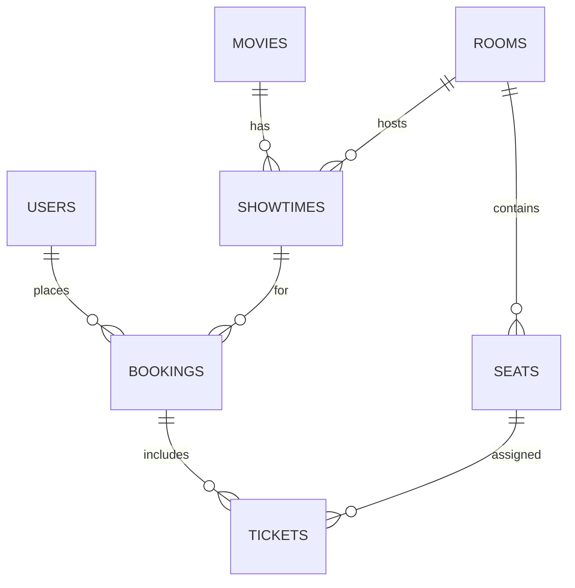

# Cinema Booking API

REST API đặt vé xem phim bằng FastAPI, SQLAlchemy và JWT. Dự án tách rõ ba tầng
API -> nghiệp vụ -> dữ liệu; tầng nghiệp vụ là Python thuần và được bảo vệ bằng
`import-linter`.

## Chức năng

- Khách xem phim, suất chiếu và sơ đồ ghế; đăng ký và đăng nhập.
- Customer đặt 1-8 ghế, xem booking của mình, hủy trước giờ chiếu.
- Admin tạo/xóa phim và suất chiếu, tạo/list phòng cùng sơ đồ ghế.
- UNIQUE `(showtime_id, seat_id)` bảo vệ chống bán trùng ghế khi có cạnh tranh.
- SQLite dùng cho phát triển/test; PostgreSQL 16 dùng trong Docker.

Không bao gồm thanh toán thật, giữ ghế tạm, khuyến mãi, email hay refresh token.
Các quyết định kỹ thuật chi tiết nằm tại `docs/api-decisions.md`.

## Kiến trúc

```text
Client -> AuthMiddleware -> FastAPI routers -> domain services -> ports
                                                       ^
                          SQLAlchemy/JWT/bcrypt adapters
```

- `src/cinema_booking/domain`: dataclass, enum, lỗi, ports và services.
- `src/cinema_booking/infrastructure`: ORM, repository, UoW, bcrypt và JWT.
- `src/cinema_booking/api`: schema, middleware, router, error mapping và composition root.

Mỗi use case chạy trong một Unit of Work. Commit phải được gọi tường minh; nếu
không, transaction tự rollback khi rời context manager.

## Mô hình dữ liệu



Tiền lưu bằng số nguyên VND. Mọi thời điểm lưu theo UTC và API trả ISO 8601 có
múi giờ. Giá VIP được tính bằng `base_price * 13 // 10`.

## API

| Method | Path | Quyền |
|---|---|---|
| GET | `/health` | Public |
| POST | `/auth/register`, `/auth/login` | Public |
| GET | `/auth/me` | Authenticated |
| GET | `/movies`, `/movies/{id}` | Public |
| POST, DELETE | `/movies`, `/movies/{id}` | Admin |
| GET, POST | `/rooms` | Admin |
| GET | `/showtimes`, `/showtimes/{id}/seats` | Public |
| POST, DELETE | `/showtimes`, `/showtimes/{id}` | Admin |
| POST, GET | `/bookings` | Authenticated |
| GET, DELETE | `/bookings/{id}` | Owner hoặc Admin |

Swagger: <http://localhost:8000/docs>. Nhấn **Authorize** và nhập JWT nhận từ
`POST /auth/login`.

Lỗi có cấu trúc thống nhất:

```json
{"code":"SEAT_UNAVAILABLE","message":"One or more seats are unavailable","details":{"seat_ids":["..."]}}
```

## Chạy local

Yêu cầu Python 3.12+.

```bash
python -m venv .venv
# Windows: .venv\Scripts\activate
# Linux/macOS: source .venv/bin/activate
pip install -e ".[dev]"
cp .env.example .env
```

Đổi `JWT_SECRET` trong `.env`, sau đó:

```bash
uvicorn cinema_booking.api.app:app --reload
```

Tạo dữ liệu mẫu (script idempotent):

```powershell
$env:SEED_ADMIN_PASSWORD="change-this-password"
python scripts/seed.py
```

Tài khoản admin mẫu là `admin@example.com`, mật khẩu là giá trị của
`SEED_ADMIN_PASSWORD` ở lần seed đầu tiên.

## Docker

```bash
cp .env.example .env
docker compose up --build -d
docker compose exec -e SEED_ADMIN_PASSWORD=change-this-password api python scripts/seed.py
```

Compose chạy API bằng user không phải root, chờ PostgreSQL healthy và lưu dữ liệu
trong named volume. Số worker cấu hình qua `WEB_WORKERS`.

## Kiểm thử và chất lượng

```bash
ruff check .
lint-imports
pytest --cov=cinema_booking --cov-report=term-missing
docker build .
```

Test gồm unit test cho BR-01..BR-12, API flow đăng ký -> đăng nhập -> đặt -> xem
-> hủy -> đặt lại, mapping/rollback repository và unique constraint chống ghế
trùng. CI chạy cùng các lệnh trên với Python 3.12.

## Kiểm thử tải

Seed ứng dụng trước, rồi sinh user/token:

```bash
python scripts/generate_load_test_data.py
```

Chọn một trong `browse`, `mixed`, `contention`, `login`:

```bash
LOAD_SCENARIO=contention locust -f load_tests/locustfile.py \
  --headless -H http://localhost:8000 -u 50 -r 10 -t 2m \
  --csv load_tests/results/contention-50
```

Trong kịch bản contention, HTTP 409 là kết quả nghiệp vụ hợp lệ; chỉ 5xx là lỗi
hệ thống. Sau khi chạy cần xác nhận truy vấn sau trả 0 dòng:

```sql
SELECT showtime_id, seat_id, COUNT(*)
FROM tickets
GROUP BY showtime_id, seat_id
HAVING COUNT(*) > 1;
```

Notebook `notebooks/kaggle_load_test.ipynb` hướng dẫn chạy các mức 10/50/100/200
user và xuất CSV. Kết quả đo phụ thuộc phần cứng nên không commit số liệu giả;
hãy điền biểu đồ RPS/p95 sau khi chạy trên Kaggle.

## Demo đề xuất

1. Seed dữ liệu và đăng nhập admin.
2. Admin tạo phim, phòng và suất chiếu.
3. Customer đăng ký, đăng nhập và đặt ghế.
4. Hai customer tranh cùng ghế: một request nhận 201, request còn lại nhận 409.
5. Customer hủy booking; ghế trở lại `AVAILABLE` và có thể đặt lại.
