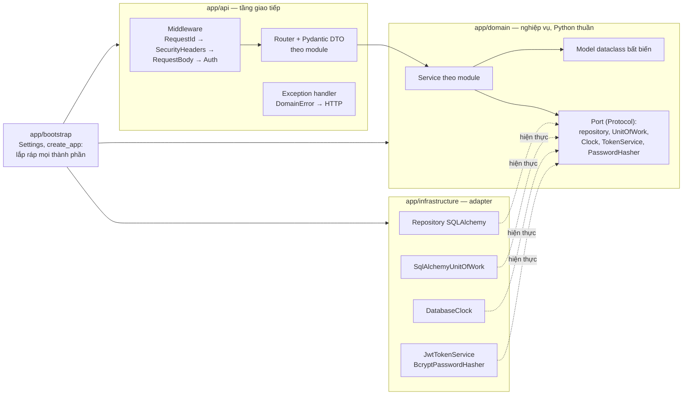

# Kiến trúc

Mô tả kiến trúc của hệ thống đặt vé xem phim

## 1. Sơ đồ tổng thể

### 1.1. C4 mức 1 — Ngữ cảnh hệ thống

```mermaid
flowchart TB
    guest["👤 Khách<br/><i>chưa đăng nhập</i><br/>Xem phim, lịch chiếu, sơ đồ ghế; đăng ký"]
    customer["👤 Khách hàng<br/><i>CUSTOMER</i><br/>Giữ ghế, xác nhận, hủy, xem vé"]
    admin["👤 Quản trị viên<br/><i>ADMIN</i><br/>Quản lý phim, phòng, suất chiếu, người dùng"]
    system["<b>Hệ thống đặt vé xem phim</b><br/>Ứng dụng web cho một rạp nhiều phòng:<br/>lịch chiếu, giữ ghế, xác nhận vé mô phỏng"]
    guest -- " HTTPS, trình duyệt " --> system
    customer -- " HTTPS, trình duyệt " --> system
    admin -- " HTTPS, trình duyệt " --> system
    classDef person fill: #08427b, color: #fff, stroke: #052e56
    classDef sys fill: #1168bd, color: #fff, stroke: #0b4884
class guest, customer, admin, dev person
class system sys
```

Hệ thống **không** tích hợp hệ thống ngoài nào: không có cổng thanh toán, email/SMS hay hệ thống soát vé (requirements
mục 1.3). Xác nhận đặt vé là mô phỏng thanh toán. TLS do reverse proxy phía trước đảm nhiệm (`AS-05`).

### 1.2. C4 mức 2 — Container

```mermaid
flowchart TB
    user["👤 Khách / Khách hàng / Quản trị viên"]
    k6["k6<br/><i>load generator, Kaggle CPU</i>"]

    subgraph system["Hệ thống đặt vé xem phim"]
        spa["<b>Web SPA</b><br/><i>React 19, TypeScript, Vite</i><br/>Giao diện khách và trang quản trị;<br/>chạy trong trình duyệt"]
        api["<b>API application</b><br/><i>Python 3.12, FastAPI, Uvicorn</i><br/>REST JSON /api/v1, xác thực JWT,<br/>nghiệp vụ; phục vụ luôn file tĩnh của SPA"]
        db[("<b>Database</b><br/><i>PostgreSQL 16</i><br/>Người dùng, danh mục,<br/>booking, inventory ghế")]
        migrate["<b>Migrate job</b><br/><i>Alembic</i><br/>Đưa schema lên head<br/>trước khi API chạy"]
        seed["<b>Seed job</b><br/><i>Python script</i><br/>ADMIN, phim, phòng,<br/>suất chiếu mẫu"]
    end

    user -- " HTTPS " --> spa
    user -- " tải SPA: GET / " --> api
    spa -- " JSON/HTTP, Bearer JWT<br/>/api/v1/* " --> api
    k6 -- " JSON/HTTP<br/>/api/v1/* " --> api
    api -- " SQL, psycopg 3<br/>pool kết nối " --> db
    migrate -- " DDL " --> db
    seed -- " SQL qua repository " --> db
    classDef container fill: #438dd5, color: #fff, stroke: #2e6295
    classDef job fill: #85bbf0, color: #000, stroke: #5d82a8
    classDef ext fill: #999, color: #fff, stroke: #6b6b6b
class spa, api, db container
class migrate,seed job
class user,k6 ext
```

| Container       | Công nghệ                                    | Trách nhiệm                                                                                                     | Triển khai                                                                                                                                                                        |
|-----------------|----------------------------------------------|-----------------------------------------------------------------------------------------------------------------|-----------------------------------------------------------------------------------------------------------------------------------------------------------------------------------|
| Web SPA         | React 19, TypeScript, React Router 7, Vite 8 | Hiển thị phim, lịch chiếu, sơ đồ ghế, vé; trang quản trị; giữ token trong `localStorage` và gửi kèm mọi request | Build thành file tĩnh trong `frontend/dist`, được API phục vụ cùng cổng 8080 (cùng origin, không cần CORS). Khi phát triển, Vite chạy ở 5173 và proxy `/api`, `/health` sang 8080 |
| API application | FastAPI trên Uvicorn                         | Toàn bộ nghiệp vụ, xác thực, phân quyền, hợp đồng REST, Swagger `/docs`, health check                           | Service `app` trong Docker Compose; số worker qua `WEB_WORKERS`                                                                                                                   |
| Database        | PostgreSQL 16                                | Nguồn dữ liệu duy nhất và nguồn quyết định cấp ghế (`CON-07`); đồng hồ quyết định (`CON-06`)                    | Service `db`, volume `postgres-data`                                                                                                                                              |
| Migrate job     | Alembic                                      | Chạy `alembic upgrade head`                                                                                     | Service `migrate`, chạy một lần; `app` chỉ khởi động khi job này thành công                                                                                                       |
| Seed job        | `scripts/seed.py`                            | Tạo dữ liệu mẫu, chạy lại không tạo trùng                                                                       | Service `seed` (profile `tools`), chạy tay                                                                                                                                        |

Trên Kaggle không có Docker daemon (`CON-09`), nên API, PostgreSQL và k6 chạy trực tiếp trong notebook với cùng phiên
bản phần mềm và cấu hình. Chi tiết ở [benchmark-plan.md](./benchmark-plan.md).

---

## 2. Các thành phần chính

### 2.1. Phân tầng trong API

API là **modular monolith**: mỗi module nghiệp vụ đi qua đủ các tầng, và mọi phụ thuộc hướng vào tầng domain.



| Tầng                 | Trách nhiệm                                                                                                                                                                | Không được làm                                                                                               |
|----------------------|----------------------------------------------------------------------------------------------------------------------------------------------------------------------------|--------------------------------------------------------------------------------------------------------------|
| `app/api`            | Routing; kiểm tra DTO bằng Pydantic (từ chối trường lạ); lấy danh tính người gọi từ middleware; gọi service; đổi kết quả và lỗi thành JSON theo hợp đồng lỗi               | Truy cập DB hay persistence; chứa quy tắc nghiệp vụ; tự xác minh token trong router                          |
| `app/domain`         | Model, quy tắc nghiệp vụ `BR-01` … `BR-30`, kiểm tra vai trò và quyền sở hữu; khai báo port mà mình cần                                                                    | Import FastAPI, Starlette, Pydantic, SQLAlchemy, psycopg, PyJWT, bcrypt, hoặc `app.api`/`app.infrastructure` |
| `app/infrastructure` | Hiện thực port: repository bằng SQLAlchemy (ORM cho dữ liệu thường, Core cho câu lệnh khóa và cập nhật có điều kiện trên inventory), Unit of Work, đồng hồ DB, JWT, bcrypt | Chứa quy tắc nghiệp vụ; trả HTTP response                                                                    |
| `app/bootstrap`      | Đọc cấu hình từ biến môi trường; tạo engine và session factory; khởi tạo service; đăng ký middleware, router, exception handler; mount SPA                                 | Chứa quy tắc nghiệp vụ                                                                                       |

**Middleware** chạy theo thứ tự cố định, nên cả lỗi xác thực cũng có `requestId` và header bảo mật:

| Thứ tự | Middleware                  | Việc                                                                                                                            |
|--------|-----------------------------|---------------------------------------------------------------------------------------------------------------------------------|
| 1      | `RequestIdMiddleware`       | Sinh `requestId`, trả header `X-Request-Id`, ghi một dòng log cho mỗi request (`NFR-06`)                                        |
| 2      | `SecurityHeadersMiddleware` | Thêm CSP, `nosniff`, `X-Frame-Options`, `Referrer-Policy` (`NFR-08`)                                                            |
| 3      | `RequestBodyMiddleware`     | Chặn body > 64 KB (`413`) và Content-Type khác JSON (`415`) (`NFR-05`)                                                          |
| 4      | `AuthMiddleware`            | Nơi **duy nhất** xác minh Bearer JWT. Mọi route dưới `/api/` cần token, trừ danh sách công khai; route mới mặc định được bảo vệ |

### 2.2. Module nghiệp vụ

| Module       | Sở hữu                                            | Endpoint                                                                | Use case             |
|--------------|---------------------------------------------------|-------------------------------------------------------------------------|----------------------|
| `auth`       | `users`                                           | `/auth/*`, `/admin/users`                                               | UC-01, UC-02, UC-13  |
| `catalog`    | `movies`                                          | `/movies`, `/admin/movies`                                              | UC-03, UC-10         |
| `cinema`     | `rooms`, `seats`                                  | `/admin/auditoriums`                                                    | UC-11                |
| `scheduling` | `showtimes`; tính giá ghế (`BR-10`); mở/ngừng bán | `/showtimes`, `/admin/showtimes`                                        | UC-04, UC-12         |
| `booking`    | `bookings`, `booking_items`, `showtime_seats`     | `/bookings`, `/me/bookings`, `/showtimes/{id}/seats`, `/admin/bookings` | UC-05 … UC-09, UC-14 |

### 2.3. Frontend

| Thành phần                       | Trách nhiệm                                                                                                                                                            |
|----------------------------------|------------------------------------------------------------------------------------------------------------------------------------------------------------------------|
| `src/router.tsx`                 | Định tuyến: `/`, `/movies/:movieId`, `/login`, `/register`, `/tickets`, `/tickets/:bookingId`, `/admin`                                                                |
| `src/app/AppShell.tsx`           | Khung trang; giữ phiên đăng nhập (token trong `localStorage`) và thông tin người dùng hiện tại                                                                         |
| `src/components/RequireRole.tsx` | Chặn trang vé với người không phải `CUSTOMER` và trang quản trị với người không phải `ADMIN` (`AC-17.6`). Đây chỉ là trải nghiệm giao diện; quyền thật do API kiểm tra |
| `src/pages/*`                    | Trang chủ, chi tiết phim kèm lịch chiếu và sơ đồ ghế, đăng nhập/đăng ký, danh sách và chi tiết vé, quản trị                                                            |
| `src/components/*`               | Sơ đồ ghế, tóm tắt booking, quản trị phim/phòng/suất chiếu, trạng thái tải và lỗi                                                                                      |
| `src/lib/apiClient.ts`           | Lớp gọi API duy nhất: thêm tiền tố `/api/v1`, header `Authorization`, đổi body lỗi thành `ApiError` có `status` và `code`                                              |
| `src/lib/formatters.ts`          | Hiển thị tiền `117.000 đ` và giờ theo giờ Việt Nam                                                                                                                     |

Giao diện xử lý lỗi theo `error.code`, không theo câu chữ; ví dụ `SEAT_UNAVAILABLE` thì báo lỗi và tải lại sơ đồ ghế
(`AC-17.4`).

---

## 3. Tech stack và lý do chọn

### 3.1. Lựa chọn công nghệ

| Thành phần       | Lựa chọn                                         | Lý do                                                                                                                                                                                                | Phương án đã cân nhắc                                                                                                           |
|------------------|--------------------------------------------------|------------------------------------------------------------------------------------------------------------------------------------------------------------------------------------------------------|---------------------------------------------------------------------------------------------------------------------------------|
| Kiểu kiến trúc   | Modular monolith, clean architecture             | Giữ ghế, xác nhận, hủy phải nguyên tử trên nhiều bảng (`CON-04`): một tiến trình và một DB cho phép dùng một transaction. Ranh giới module và tầng vẫn tách được và kiểm tra tự động được (`CON-02`) | Microservices: cần giao dịch phân tán cho đặt vé, nằm ngoài phạm vi (mục 1.3)                                                   |
| Ngôn ngữ backend | Python 3.12                                      | Kiểu tĩnh với mypy strict; `Protocol` cho phép khai báo port mà domain không phụ thuộc framework                                                                                                     | —                                                                                                                               |
| Web framework    | FastAPI trên Uvicorn                             | DTO bằng Pydantic sinh luôn OpenAPI và Swagger UI (tiêu chí nghiệm thu Pha 1, requirements mục 6.4); middleware ASGI để xác thực tập trung; chạy nhiều worker                                        | Flask: thiếu kiểm tra DTO và OpenAPI sẵn có. Django: ORM và cấu trúc app khó tách khỏi tầng domain                              |
| Truy cập dữ liệu | SQLAlchemy 2                                     | ORM làm data mapper cho dữ liệu thường (`CON-03`); Core cho câu `SELECT … FOR UPDATE` và `UPDATE` có điều kiện trả `rowcount`, đúng cơ chế chống bán trùng (`CON-05`)                                | Chỉ dùng ORM: khó kiểm soát câu SQL ở đường ghi nóng. SQL thuần: mất ánh xạ và kiểm tra `alembic check`                         |
| Migration        | Alembic                                          | Đi cùng SQLAlchemy; `alembic check` trong CI phát hiện model và migration lệch nhau                                                                                                                  | —                                                                                                                               |
| Database         | PostgreSQL 16                                    | Khóa dòng, transaction, `CHECK`, khóa ngoại để bảo vệ quy tắc ở DB; `clock_timestamp()` làm nguồn thời gian duy nhất (`CON-06`); có sẵn và cài được trên Kaggle                                      | SQLite: chỉ dùng cho kiểm thử nhanh, không chứng minh được hành vi khóa đồng thời. MySQL: không có lợi thế rõ ràng cho bài toán |
| Driver DB        | psycopg 3                                        | Driver PostgreSQL chính thức cho SQLAlchemy 2                                                                                                                                                        | —                                                                                                                               |
| Xác thực         | JWT HS256 (PyJWT)                                | Không cần session phía server, nên mở rộng ngang dễ (`NFR-09`); một khóa ký từ biến môi trường (`NFR-08`)                                                                                            | Session lưu trong DB: thêm truy vấn mỗi request và trạng thái chia sẻ giữa worker                                               |
| Hash mật khẩu    | bcrypt, cost 12                                  | Thuật toán chậm có salt, chuẩn phổ biến (`NFR-08`)                                                                                                                                                   | Argon2: tốt hơn về lý thuyết nhưng không cần thiết ở phạm vi này                                                                |
| Frontend         | React 19, TypeScript, React Router 7             | SPA nhiều trạng thái tương tác (sơ đồ ghế, đếm ngược giữ ghế); TypeScript bắt lỗi kiểu dữ liệu API khi build                                                                                         | Trang render phía server: khó làm sơ đồ ghế tương tác và phải trộn giao diện vào backend                                        |
| Build frontend   | Vite 8                                           | Dev server nhanh, proxy sang API; build ra file tĩnh để backend phục vụ cùng origin                                                                                                                  | —                                                                                                                               |
| Quản lý gói      | uv (`uv.lock`), npm (`package-lock.json`)        | Lockfile cố định phiên bản, cài lại giống hệt từ môi trường sạch (`NFR-07`)                                                                                                                          | pip + requirements.txt: không khóa phụ thuộc bắc cầu chặt bằng                                                                  |
| Chất lượng mã    | pytest, ruff, mypy strict, import-linter, ESLint | Kiểm thử, định dạng, kiểu tĩnh và ranh giới kiến trúc đều chạy tự động trong CI (`NFR-10`)                                                                                                           | —                                                                                                                               |
| Đóng gói         | Docker multi-stage, Docker Compose               | Một image chứa cả API và SPA đã build; Compose sắp thứ tự `db` → `migrate` → `app` (`CON-08`)                                                                                                        | Kubernetes: ngoài phạm vi                                                                                                       |
| Đo tải           | k6                                               | Script JavaScript tái lập được, chạy được trên Kaggle không cần Docker (`DP-03`)                                                                                                                     | Locust: tốn CPU hơn trên máy dùng chung với backend (`RI-03`)                                                                   |

### 4.2. Những gì cố tình chưa có

| Không có                             | Lý do                                                                                                                      |
|--------------------------------------|----------------------------------------------------------------------------------------------------------------------------|
| Cache                                | PostgreSQL là nguồn quyết định cấp ghế (`CON-07`). Cache là ứng viên của Pha 2, chỉ thêm khi số liệu baseline cho thấy cần |
| Tác vụ nền thu hồi hold              | Đường ghi tự cấp lại ghế hết hạn, nên tính đúng đắn không phụ thuộc tác vụ nền (`FR-08`)                                   |
| Message queue, event bus             | Mọi luồng đều đồng bộ trong một transaction; không có hệ thống ngoài cần thông báo                                         |
| Idempotency key cho `POST /bookings` | Client không tự gửi lại khi chưa biết kết quả mà xem lại danh sách vé (`FR-05`)                                            |
| Refresh token, thu hồi token         | Ngoài phạm vi (`AS-04`)                                                                                                    |
| Giới hạn tần suất                    | Ngoài phạm vi (`AS-07`, `RI-10`)                                                                                           |
