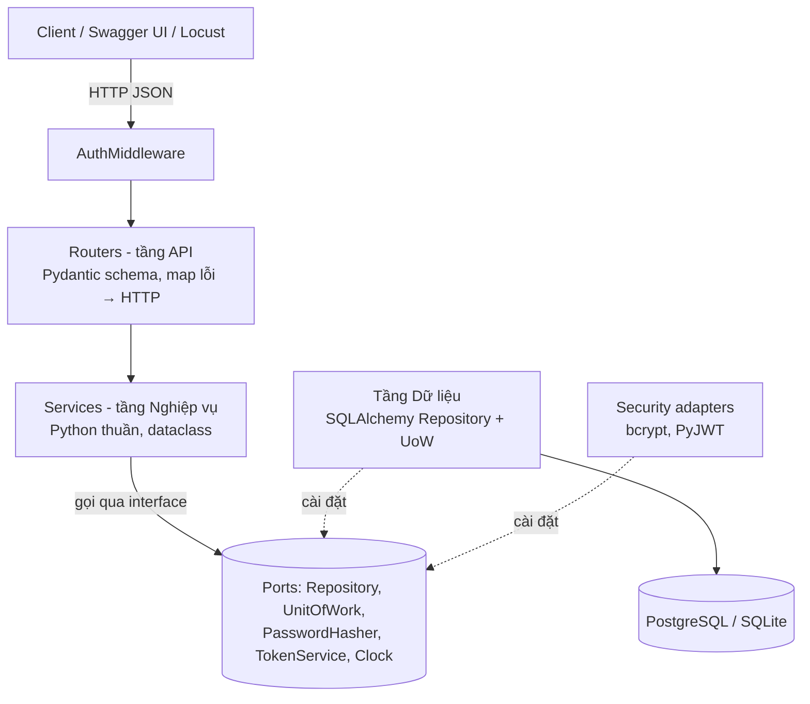
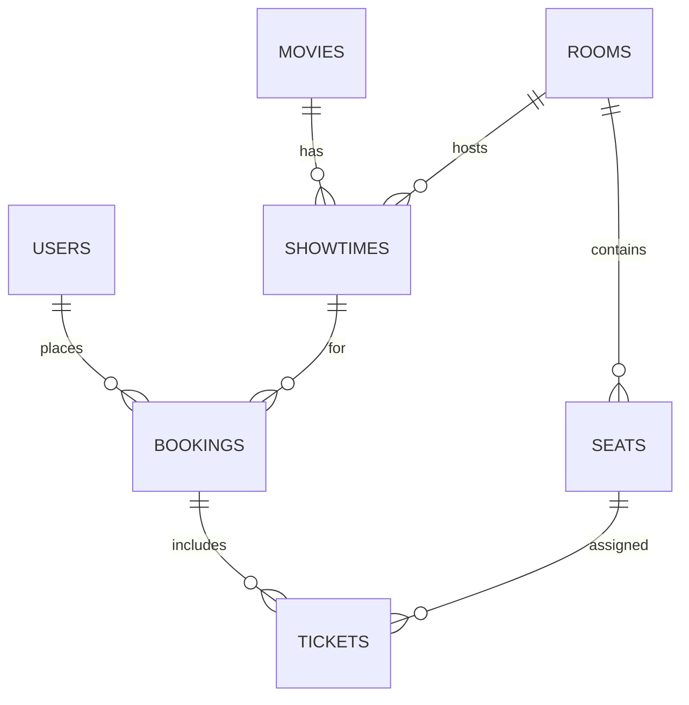
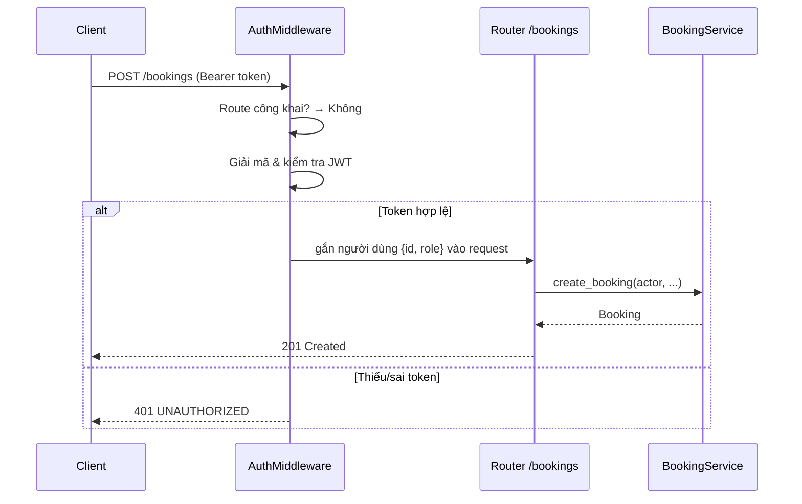

# Brainstorm 001 — Hệ thống đặt vé xem phim

---

## 1. Bài toán

Khách hàng muốn xem lịch chiếu, chọn ghế và giữ vé mà không bị trùng ghế với người khác. Quản trị viên cần quản lý phim, phòng chiếu và suất chiếu.

**Phạm vi (chỉ chức năng cơ bản):**

| Vai trò | Làm được gì |
|---|---|
| Khách (chưa đăng nhập) | Xem danh sách phim, suất chiếu, sơ đồ ghế; đăng ký; đăng nhập |
| Khách hàng (`CUSTOMER`) | Đặt vé (chọn nhiều ghế trong 1 suất), xem vé của mình, hủy vé |
| Quản trị (`ADMIN`) | Thêm/xóa phim, phòng chiếu, suất chiếu |

**Ngoài phạm vi:** thanh toán thật, giữ ghế tạm có thời hạn, khuyến mãi, gửi email, refresh token.

---

## 2. Đối chiếu yêu cầu đề bài

| Yêu cầu | Cách đáp ứng | Mục |
|---|---|---|
| REST + JSON | FastAPI, mọi request/response là JSON | §6 |
| Có POST, GET, DELETE | Đặt vé (POST), xem phim (GET), hủy vé (DELETE),… | §6 |
| Tài liệu OpenAPI/Swagger | FastAPI tự sinh schema OpenAPI và giao diện Swagger | §6 |
| Phân tầng API → Nghiệp vụ → Dữ liệu | Ba tầng tách biệt | §3 |
| Tầng nghiệp vụ không phụ thuộc web/DB | Chỉ dùng thư viện chuẩn; kiểm tra tự động bằng `import-linter` | §3.2 |
| Repository + ORM | Repository cài đặt bằng SQLAlchemy ORM | §5 |
| Đăng nhập | Đăng nhập trả về JWT | §7 |
| ≥1 GET và ≥1 POST cần xác thực | Xem vé của tôi, thông tin tài khoản, đặt vé,… | §6 |
| Xác thực qua middleware | Một middleware xác thực duy nhất, mặc định chặn, có danh sách route công khai | §7 |
| Docker | Image multi-stage + docker compose (API + Postgres) | §9 |
| GitHub + README | Quy ước commit và nội dung README | §11 |
| Kiểm thử tải trên Kaggle CPU | Notebook chạy API + Locust headless | §10 |

---

## 3. Kiến trúc

### 3.1. Sơ đồ tầng

- **Luồng gọi** đi đúng thứ tự API → Nghiệp vụ → Dữ liệu.
- **Chiều phụ thuộc mã nguồn** dùng nguyên lý đảo ngược phụ thuộc: tầng nghiệp vụ định nghĩa *interface* (port), tầng dữ liệu cài đặt chúng. Nhờ vậy tầng nghiệp vụ không cần biết SQLAlchemy tồn tại.
- Việc "ráp" các tầng lại (tạo session, repository, service) nằm ở tầng API — đây là *composition root*, chỉ tầng API được phép biết mọi tầng.

### 3.2. Giữ tầng nghiệp vụ "sạch" và chứng minh được

Không chỉ hứa, mà kiểm tra tự động trong CI bằng [`import-linter`](https://import-linter.readthedocs.io), với hai hợp đồng:

- **Tầng nghiệp vụ thuần:** cấm tầng nghiệp vụ import FastAPI, Starlette, Pydantic, SQLAlchemy, driver Postgres, thư viện JWT, bcrypt, cũng như các tầng API, dữ liệu và bảo mật.
- **Thứ tự tầng:** tầng API được phụ thuộc tầng nghiệp vụ, không có chiều ngược lại.

Nếu ai lỡ import SQLAlchemy trong tầng nghiệp vụ, CI đỏ. Đây cũng là điểm dễ trình bày khi bảo vệ.

---

## 4. Mô hình nghiệp vụ

### 4.1. Thực thể

Các thực thể là dataclass thuần ở tầng nghiệp vụ, không phụ thuộc thư viện ngoài.

| Thực thể | Thuộc tính chính |
|---|---|
| `User` | id, email, password_hash, full_name, role (`CUSTOMER`/`ADMIN`), created_at |
| `Movie` | id, title, duration_minutes, genre, age_rating, description |
| `Room` | id, name, rows, cols |
| `Seat` | id, room_id, row_label (A, B, …), number, seat_type (`STANDARD`/`VIP`) |
| `Showtime` | id, movie_id, room_id, starts_at, ends_at, base_price |
| `Booking` | id, user_id, showtime_id, status (`CONFIRMED`/`CANCELLED`), total_price, created_at |
| `Ticket` | id, booking_id, showtime_id, seat_id, price |

Tiền lưu bằng số nguyên (VND) để tránh lỗi làm tròn số thực.

### 4.2. Quy tắc nghiệp vụ

| Mã | Quy tắc | Lỗi nghiệp vụ |
|---|---|---|
| BR-01 | Email đăng ký là duy nhất | `EmailAlreadyUsed` |
| BR-02 | Mật khẩu ≥ 8 ký tự | `BusinessRuleViolation` |
| BR-03 | Chỉ `ADMIN` được tạo/xóa phim, phòng, suất chiếu | `Forbidden` |
| BR-04 | Suất chiếu không trùng giờ với suất khác trong cùng phòng (giờ kết thúc = giờ bắt đầu + thời lượng phim) | `ShowtimeOverlap` |
| BR-05 | Không đặt vé cho suất đã bắt đầu | `ShowtimeAlreadyStarted` |
| BR-06 | Mỗi lần đặt 1–8 ghế, không trùng nhau | `BusinessRuleViolation` |
| BR-07 | Ghế phải thuộc phòng của suất chiếu | `BusinessRuleViolation` |
| BR-08 | **Một ghế chỉ được bán một lần trong một suất** | `SeatUnavailable` (→ 409) |
| BR-09 | Giá vé = giá cơ bản × hệ số ghế (STANDARD 1.0, VIP 1.3) | — |
| BR-10 | Chỉ chủ vé (hoặc ADMIN) được xem/hủy booking | `Forbidden` |
| BR-11 | Chỉ hủy được trước giờ chiếu; hủy thì ghế được trả lại | `ShowtimeAlreadyStarted` |
| BR-12 | Không xóa phim/suất chiếu đã có vé `CONFIRMED` | `BusinessRuleViolation` |

Kiểm tra quyền (BR-03, BR-10) đặt ở tầng nghiệp vụ: service nhận thông tin người dùng hiện tại (`actor`) do middleware xác thực. Middleware trả lời câu hỏi *"bạn là ai?"*, service trả lời *"bạn có được làm việc này không?"*.

### 4.3. Ports (interface do tầng nghiệp vụ định nghĩa)

| Port | Trách nhiệm |
|---|---|
| Repository cho từng thực thể (User, Movie, Room, Seat, Showtime, Booking) | Đọc/ghi thực thể; Showtime có thêm truy vấn tìm suất trùng giờ trong phòng; Booking có thêm truy vấn danh sách ghế đã bán của một suất |
| `UnitOfWork` | Gom các repository vào một giao dịch; commit tường minh, tự rollback nếu chưa commit |
| `PasswordHasher` | Băm và kiểm tra mật khẩu |
| `TokenService` | Phát hành và giải mã token |
| `Clock` | Trả về thời điểm hiện tại |

`Clock` giúp test BR-05/BR-11 dễ dàng (giả lập "bây giờ") mà không cần chờ thời gian thật. Repository Booking khi lưu sẽ báo `SeatUnavailable` nếu ghế đã có người đặt.

### 4.4. Use case trọng tâm: đặt vé

Các bước xử lý trong service đặt vé, tất cả trong **một giao dịch**:

1. Kiểm tra số ghế 1–8 và không trùng nhau (BR-06).
2. Lấy suất chiếu; không có thì báo `NotFound`.
3. Suất đã bắt đầu thì từ chối (BR-05).
4. Lấy các ghế; ghế nào không tồn tại hoặc không thuộc phòng của suất thì từ chối (BR-07).
5. Kiểm tra sớm xem ghế đã bị bán chưa (BR-08) — trả lỗi rõ ràng cho trường hợp thường gặp.
6. Tính giá từng vé theo hệ số ghế (BR-09), cộng tổng thành giá booking.
7. Lưu booking cùng các vé; ràng buộc UNIQUE trong CSDL là hàng rào cuối cùng (BR-08).
8. Commit.

### 4.5. Chống đặt trùng ghế khi nhiều người cùng bấm

Bước kiểm tra sớm ở trên **không đủ** khi có đồng thời: hai request cùng đọc thấy ghế trống rồi cùng ghi. Cách giải quyết đơn giản và đúng:

1. Bảng `tickets` có ràng buộc **`UNIQUE (showtime_id, seat_id)`**. Cơ sở dữ liệu đảm bảo chỉ một giao dịch thắng.
2. Khi hủy vé, xóa các dòng `tickets` (booking giữ lại với status `CANCELLED`) để ghế được bán lại.
3. Repository bắt lỗi vi phạm ràng buộc của SQLAlchemy và đổi thành `SeatUnavailable` của tầng nghiệp vụ → API trả **409 Conflict**.

Tầng nghiệp vụ chỉ biết `SeatUnavailable`, không biết lỗi của SQLAlchemy — đúng nguyên tắc phân tầng. Kịch bản kiểm thử tải §10 sẽ chứng minh không có ghế nào bị bán hai lần.

---

## 5. Tầng truy cập dữ liệu

### 5.1. Lược đồ CSDL

Các cột của mỗi bảng tương ứng với thuộc tính thực thể ở §4.1.

Ràng buộc và chỉ mục:

| Bảng | Ràng buộc / Index | Lý do |
|---|---|---|
| `users` | `UNIQUE(email)` | BR-01 |
| `rooms` | `UNIQUE(name)` | không trùng tên phòng |
| `seats` | `UNIQUE(room_id, row_label, number)` | không tạo ghế trùng |
| `tickets` | **`UNIQUE(showtime_id, seat_id)`** | BR-08, chống đặt trùng |
| `showtimes` | `INDEX(room_id, starts_at)` | kiểm tra trùng lịch nhanh |
| `showtimes` | `INDEX(movie_id, starts_at)` | lọc lịch chiếu theo phim |
| `bookings` | `INDEX(user_id)` | xem vé của tôi |

`tickets.showtime_id` được lưu lặp lại (đã có qua `booking`) có chủ đích: để đặt được ràng buộc UNIQUE ngay trên bảng.

### 5.2. Repository và Unit of Work

- Mỗi repository nhận một session SQLAlchemy, trả về **entity của tầng nghiệp vụ**, không bao giờ để ORM model lọt ra ngoài.
- Unit of Work mở session khi bắt đầu, rollback khi kết thúc nếu chưa commit; một use case = một transaction.
- Khi lưu booking, repository đẩy lệnh INSERT xuống ngay để bắt vi phạm UNIQUE tại chỗ và đổi thành `SeatUnavailable`.
- Khởi tạo bảng tự động khi khởi động (đủ cho phạm vi bài tập; Alembic là tùy chọn).
- Chuỗi kết nối CSDL cấu hình được: PostgreSQL khi chạy Docker, SQLite cho test và có thể cho Kaggle.

---

## 6. Đặc tả API

Swagger UI và ReDoc do FastAPI tự sinh. Xác thực bằng header `Authorization: Bearer <JWT>`.

### 6.1. Danh sách endpoint

| Method | Path | Xác thực | Mô tả |
|---|---|---|---|
| GET | `/health` | — | Kiểm tra sống |
| POST | `/auth/register` | — | Đăng ký tài khoản CUSTOMER |
| POST | `/auth/login` | — | Đăng nhập, trả JWT |
| GET | `/auth/me` | ✅ | Thông tin người dùng hiện tại |
| GET | `/movies` | — | Danh sách phim (tìm kiếm, phân trang) |
| GET | `/movies/{id}` | — | Chi tiết phim |
| POST | `/movies` | ✅ ADMIN | Thêm phim |
| DELETE | `/movies/{id}` | ✅ ADMIN | Xóa phim (BR-12) |
| GET | `/rooms` | ✅ ADMIN | Danh sách phòng |
| POST | `/rooms` | ✅ ADMIN | Tạo phòng, tự sinh ghế theo số hàng × số cột (tùy chọn hàng VIP) |
| GET | `/showtimes` | — | Lịch chiếu (lọc theo phim, ngày) |
| GET | `/showtimes/{id}/seats` | — | Sơ đồ ghế kèm trạng thái `AVAILABLE`/`BOOKED` |
| POST | `/showtimes` | ✅ ADMIN | Tạo suất chiếu (BR-04) |
| DELETE | `/showtimes/{id}` | ✅ ADMIN | Xóa suất chiếu (BR-12) |
| POST | `/bookings` | ✅ | **Đặt vé** |
| GET | `/bookings` | ✅ | **Vé của tôi** |
| GET | `/bookings/{id}` | ✅ | Chi tiết booking (BR-10) |
| DELETE | `/bookings/{id}` | ✅ | **Hủy vé** (BR-11) |

Đủ yêu cầu: GET cần xác thực (`/bookings`, `/auth/me`), POST cần xác thực (`/bookings`, `/movies`), DELETE (`/bookings/{id}`, `/movies/{id}`).

### 6.2. Dữ liệu trao đổi chính

- **Đăng nhập:** gửi email + mật khẩu, nhận về access token, loại token (bearer) và thời hạn.
- **Sơ đồ ghế:** trả về thông tin phòng và danh sách ghế, mỗi ghế có nhãn (A1, H1…), loại ghế, giá đã tính theo hệ số và trạng thái còn trống/đã bán.
- **Đặt vé:** gửi mã suất chiếu + danh sách mã ghế; nhận về booking (201 Created) gồm trạng thái, tổng tiền, danh sách vé và thời điểm tạo.
- **Hủy vé:** trả về 204 No Content.

### 6.3. Định dạng lỗi thống nhất

Mọi lỗi trả về cùng một cấu trúc gồm **mã lỗi**, **thông điệp** và **chi tiết** (ví dụ danh sách ghế đã bị đặt).

| Lỗi nghiệp vụ / tình huống | HTTP | Mã lỗi |
|---|---|---|
| Body sai schema (Pydantic) | 422 | `VALIDATION_ERROR` |
| `BusinessRuleViolation` | 400 | `BUSINESS_RULE_VIOLATION` |
| Thiếu/sai/hết hạn token | 401 | `UNAUTHORIZED` |
| Sai email hoặc mật khẩu | 401 | `INVALID_CREDENTIALS` |
| `Forbidden` | 403 | `FORBIDDEN` |
| `NotFound` | 404 | `NOT_FOUND` |
| `SeatUnavailable`, `EmailAlreadyUsed`, `ShowtimeOverlap` | 409 | tương ứng |
| `ShowtimeAlreadyStarted` | 409 | `SHOWTIME_ALREADY_STARTED` |

Việc chuyển đổi lỗi nghiệp vụ sang HTTP được đăng ký tập trung bằng exception handler của FastAPI, nên router không cần tự bắt lỗi.

---

## 7. Bảo mật

### 7.1. Luồng xác thực

### 7.2. AuthMiddleware — mặc định chặn

Thay vì đánh dấu từng endpoint cần bảo vệ, middleware **chặn mọi thứ** trừ danh sách công khai. Thêm endpoint mới mà quên khai báo thì nó tự động được bảo vệ — an toàn hơn cách ngược lại.

Danh sách route công khai:

- Kiểm tra sống và tài liệu API (Swagger, ReDoc, OpenAPI schema).
- Đăng nhập và đăng ký.
- Xem danh sách/chi tiết phim.
- Xem lịch chiếu và sơ đồ ghế.
- Request preflight `OPTIONS` (CORS).

Với các route còn lại, middleware đọc header Bearer; thiếu token hoặc token sai/hết hạn thì trả 401 kèm header `WWW-Authenticate`. Token hợp lệ thì gắn người dùng (id, role) vào request rồi cho đi tiếp. Router chỉ lấy người dùng ra để truyền cho service, **không** tự kiểm tra token.

> Ghi chú hiệu năng: middleware kiểu `BaseHTTPMiddleware` của Starlette dễ đọc nhưng có chút overhead. Nếu kết quả kiểm thử tải cho thấy nó là nút thắt, có thể viết lại thành pure ASGI middleware với cùng logic.

### 7.3. Chi tiết khác

| Hạng mục | Lựa chọn |
|---|---|
| Băm mật khẩu | bcrypt, độ khó cấu hình được (mặc định 12) |
| Token | JWT HS256 (PyJWT), claims `sub`, `role`, `exp`; hạn 60 phút |
| Bí mật | Khóa ký JWT lấy từ biến môi trường, không commit vào Git (chỉ commit file mẫu) |
| Phân quyền | ADMIN/CUSTOMER kiểm tra trong tầng nghiệp vụ (BR-03, BR-10) |
| Tài khoản admin | Tạo bằng script seed, không có endpoint tự nâng quyền |
| Swagger | Có nút **Authorize** nhờ khai báo security scheme Bearer trong OpenAPI |

---

## 8. Kiểm thử chức năng

| Loại | Công cụ | Nội dung |
|---|---|---|
| Unit | pytest | Service với **fake repository in-memory** + đồng hồ giả — chạy rất nhanh, không cần DB. Đây là lợi ích trực tiếp của việc tách tầng. |
| API | pytest + TestClient + SQLite | Đăng ký → đăng nhập → đặt vé → xem → hủy; 401 khi thiếu token; 403 khi CUSTOMER tạo phim; 409 khi đặt ghế đã bán |
| Kiến trúc | import-linter | Tầng nghiệp vụ không import framework |

Các test bắt buộc nên có: đặt trùng ghế trả 409; hủy vé xong ghế đặt lại được; không đặt được suất đã chiếu; tạo suất chiếu trùng giờ bị từ chối.

---

## 9. Đóng gói Docker

### 9.1. Image

- Build **multi-stage** trên `python:3.12-slim`: stage đầu cài thư viện, stage sau chỉ chép thư viện đã cài và mã nguồn → image gọn.
- Chạy bằng user thường (không phải root).
- Khởi động uvicorn ở cổng 8000, số worker cấu hình qua biến môi trường.

### 9.2. Docker Compose

- Service **db**: `postgres:16-alpine`, dữ liệu lưu trong volume, có healthcheck.
- Service **api**: build từ image trên, đọc biến môi trường từ file `.env`, chỉ khởi động khi db đã healthy, mở cổng 8000.

Cách chạy: tạo file `.env` từ file mẫu → `docker compose up` → chạy script seed để tạo admin và dữ liệu mẫu → mở Swagger UI.

### 9.3. Biến môi trường

| Biến | Mặc định | Ý nghĩa |
|---|---|---|
| `DATABASE_URL` | SQLite cục bộ | Chuỗi kết nối SQLAlchemy |
| `JWT_SECRET` | *(bắt buộc)* | Khóa ký JWT |
| `JWT_EXPIRES_MINUTES` | `60` | Hạn token |
| `BCRYPT_ROUNDS` | `12` | Độ khó băm mật khẩu |
| `WEB_WORKERS` | `2` | Số process uvicorn |
| `DB_POOL_SIZE` | `10` | Kích thước pool kết nối |

### 9.4. Thư viện

fastapi, uvicorn, sqlalchemy ≥ 2.0, psycopg, pydantic-settings, pyjwt, bcrypt; dev: pytest, httpx, import-linter, ruff, locust.

---

## 10. Kiểm thử tải trên Kaggle CPU

### 10.1. Môi trường và hạn chế cần biết

- Kaggle Notebook **không chạy được Docker** (không có Docker daemon), nên notebook sẽ clone repo công khai, cài thư viện và chạy uvicorn trực tiếp. Cần bật **Internet** trong cài đặt notebook.
- CSDL: cài PostgreSQL ngay trong notebook để giống môi trường thật. Phương án dự phòng là SQLite — nhưng SQLite khóa toàn bộ file khi ghi, nên kết quả kịch bản đặt vé sẽ kém hơn nhiều và cần ghi chú rõ trong báo cáo.
- Locust và API **dùng chung CPU** của notebook, nên số đo là cận dưới. Ghi lại số nhân CPU và RAM vào báo cáo; có thể ghim nhân riêng cho API và Locust.
- bcrypt tốn CPU có chủ đích. Nếu mọi user ảo đều đăng nhập liên tục, ta sẽ đo tốc độ băm chứ không phải hệ thống. Vì vậy sinh sẵn token cho user mẫu, và đăng nhập được đo riêng ở một kịch bản nhỏ.

### 10.2. Các bước trong notebook

1. Ghi lại cấu hình máy (số nhân, RAM).
2. Clone repo, cài thư viện và Locust.
3. Cài và khởi động PostgreSQL, tạo user và database.
4. Đặt biến môi trường (chuỗi kết nối, khóa JWT).
5. Seed dữ liệu (khoảng 2000 user, 50 suất chiếu) và sinh sẵn token ra file.
6. Chạy API nền.
7. Chạy Locust headless theo từng kịch bản, xuất kết quả ra CSV.

### 10.3. Kịch bản

| # | Kịch bản | Mô tả | Mục tiêu đo |
|---|---|---|---|
| L1 | Duyệt (đọc) | Xem phim, lịch chiếu, sơ đồ ghế | RPS tối đa, độ trễ đọc |
| L2 | Hỗn hợp | 60% duyệt, 20% xem vé của tôi, 15% đặt vé, 5% hủy vé | Hành vi gần thực tế |
| L3 | Tranh ghế | Toàn bộ user cùng đặt ghế ngẫu nhiên trong **1 suất chiếu** | Tính đúng đắn khi đồng thời |
| L4 | Đăng nhập | Chỉ gọi đăng nhập | Chi phí bcrypt |

Mỗi kịch bản chạy ở các mức **10 → 50 → 100 → 200** user ảo, mỗi mức 2 phút. So sánh thêm 1 worker với 2/4 worker để thấy ảnh hưởng của số process.

Hành vi user ảo: mỗi user lấy một token có sẵn, tải danh sách suất chiếu một lần, sau đó xen kẽ xem sơ đồ ghế, xem vé của mình và đặt 1–2 ghế còn trống ngẫu nhiên; booking thành công được ghi nhớ để có thể hủy sau.

### 10.4. Chỉ số và tiêu chí

- Từ CSV của Locust: **RPS**, độ trễ **p50 / p95 / p99**, tỷ lệ lỗi.
- Ở L3, lỗi 409 ghế đã bị đặt là kết quả **đúng** (tính là thành công); chỉ 5xx mới tính là lỗi.
- **Kiểm tra tính đúng đắn sau L3** — tiêu chí quan trọng nhất: truy vấn bảng `tickets` tìm cặp (suất chiếu, ghế) xuất hiện nhiều hơn một lần — kết quả phải là **0 dòng**.
- Theo dõi CPU song song để chỉ ra nút thắt (API, Postgres hay Locust).
- Trình bày kết quả bằng biểu đồ RPS và p95 theo số user (vẽ từ CSV) trong notebook, lưu notebook vào repo.

---

## 11. Quy trình GitHub

**Nhánh:** `main` (luôn chạy được) ← nhánh `feature/<tên>` qua Pull Request, ít nhất 1 người review.

**Commit** theo Conventional Commits (`feat`, `fix`, `test`, `docs`, `chore`… kèm phạm vi), mỗi commit một thay đổi có nghĩa.

**CI (GitHub Actions)** cho mỗi PR: lint (ruff) → kiểm tra phân tầng (import-linter) → test (pytest) → build Docker.

**README** gồm: giới thiệu nghiệp vụ; sơ đồ kiến trúc 3 tầng (§3); mô hình dữ liệu (§5); bảng endpoint + link Swagger (§6); cách xác thực (§7); chạy bằng Docker (§9); chạy test; kết quả kiểm thử tải kèm biểu đồ (§10); thành viên và phân công.

---

## 12. Lộ trình triển khai

| Giai đoạn | Việc | Sản phẩm |
|---|---|---|
| 1. Khung dự án | Repo, cấu hình dự án, luật phân tầng, CI, endpoint kiểm tra sống | CI xanh |
| 2. Nghiệp vụ | Entities, ports, lỗi nghiệp vụ, 5 service + unit test với fake repo | Toàn bộ quy tắc BR-xx có test |
| 3. Dữ liệu | ORM models, mapper, repositories, Unit of Work, seed | Chạy được với SQLite và Postgres |
| 4. API + bảo mật | Schema, router, xử lý lỗi, AuthMiddleware, JWT, bcrypt | Swagger dùng được end-to-end |
| 5. Docker | Image, compose, file biến môi trường mẫu | `docker compose up` là chạy |
| 6. Kiểm thử tải | Sinh token, kịch bản Locust, notebook Kaggle, phân tích | Báo cáo + biểu đồ trong README |
| 7. Hoàn thiện | README, dọn code, demo | Nộp bài |

**Gợi ý chia việc (nhóm 3–4 người):** một người phụ trách nghiệp vụ + unit test; một người tầng dữ liệu + seed; một người API + bảo mật + Swagger; một người Docker + CI + kiểm thử tải. Vì các tầng giao tiếp qua ports, hãy **chốt ports và entities trước tiên** — sau đó các thành viên làm song song được mà không chờ nhau.
