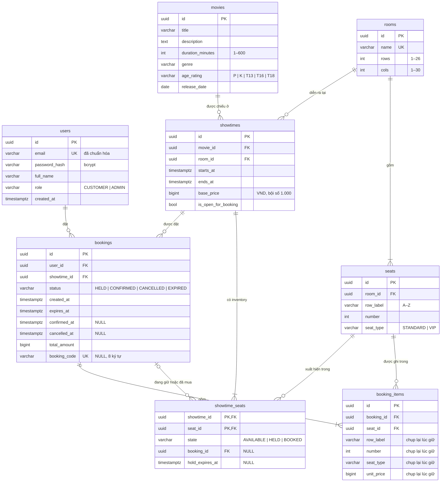

# Mô hình dữ liệu

## 1. Sơ đồ ER

---

## 2. Ràng buộc và liên kết với quy tắc nghiệp vụ

### 2.1. Ràng buộc trong DB

Tên ràng buộc theo naming convention của `Base.metadata`: `pk_<bảng>`, `uq_<bảng>_<cột>`, `ck_<bảng>_<tên>`,
`fk_<bảng>_<cột>_<bảng đích>`.

| Bảng             | Ràng buộc                                 | Định nghĩa                                                                                             | Quy tắc             |
|------------------|-------------------------------------------|--------------------------------------------------------------------------------------------------------|---------------------|
| `users`          | `uq_users_email`                          | `UNIQUE (email)`; email được chuẩn hóa (trim, chữ thường) trước khi ghi                                | BR-24               |
|                  | `ck_users_role`                           | `role IN ('CUSTOMER','ADMIN')`                                                                         | BR-25               |
| `movies`         | `ck_movies_duration_range`                | `duration_minutes BETWEEN 1 AND 600`                                                                   | BR-01               |
|                  | `ck_movies_age_rating`                    | `age_rating IN ('P','K','T13','T16','T18')`                                                            | BR-01               |
|                  | `release_date NOT NULL`                   | Mọi phim phải có ngày khởi chiếu                                                                       | BR-01, BR-02, BR-08 |
| `rooms`          | `uq_rooms_name`                           | `UNIQUE (name)`                                                                                        | BR-04               |
|                  | `ck_rooms_size`                           | `rows BETWEEN 1 AND 26 AND cols BETWEEN 1 AND 30`                                                      | BR-04               |
| `seats`          | `uq_seats_position`                       | `UNIQUE (room_id, row_label, number)`                                                                  | BR-04               |
|                  | `ck_seats_number_positive`                | `number > 0`                                                                                           | BR-04               |
|                  | `ck_seats_seat_type`                      | `seat_type IN ('STANDARD','VIP')`                                                                      | BR-05               |
|                  | `fk_seats_room_id_rooms`                  | `ON DELETE RESTRICT`                                                                                   | BR-28               |
| `showtimes`      | `ck_showtimes_window`                     | `ends_at > starts_at`                                                                                  | BR-06               |
|                  | `ck_showtimes_base_price`                 | `base_price > 0 AND base_price % 1000 = 0`                                                             | BR-10               |
|                  | `fk_showtimes_movie_id_movies`            | `ON DELETE RESTRICT`                                                                                   | BR-27               |
|                  | `fk_showtimes_room_id_rooms`              | `ON DELETE RESTRICT`                                                                                   | BR-28               |
| `bookings`       | `ck_bookings_status`                      | `status IN ('HELD','CONFIRMED','CANCELLED','EXPIRED')`                                                 | BR-23               |
|                  | `ck_bookings_confirmed`                   | `confirmed_at` và `booking_code` có giá trị **khi và chỉ khi** `status = 'CONFIRMED'`                  | BR-20               |
|                  | `ck_bookings_cancelled`                   | `cancelled_at` có giá trị khi và chỉ khi `status = 'CANCELLED'`                                        | BR-21               |
|                  | `ck_bookings_hold_window`                 | `expires_at > created_at`                                                                              | BR-17               |
|                  | `ck_bookings_total_positive`              | `total_amount > 0`                                                                                     | BR-12               |
|                  | `uq_bookings_booking_code`                | `UNIQUE (booking_code)`; NULL không tính trùng                                                         | BR-20               |
|                  | `ck_bookings_booking_code_length`         | `booking_code IS NULL OR length(booking_code) = 8`                                                     | BR-20               |
|                  | `fk_bookings_user_id_users`               | `ON DELETE RESTRICT`                                                                                   | BR-30               |
|                  | `fk_bookings_showtime_id_showtimes`       | `ON DELETE RESTRICT`                                                                                   | BR-29               |
| `booking_items`  | `uq_booking_items_booking_seat`           | `UNIQUE (booking_id, seat_id)`                                                                         | BR-14               |
|                  | `ck_booking_items_unit_price_positive`    | `unit_price > 0`                                                                                       | BR-11, BR-12        |
|                  | `fk_booking_items_booking_id_bookings`    | `ON DELETE RESTRICT`                                                                                   | BR-30               |
|                  | `fk_booking_items_seat_id_seats`          | `ON DELETE RESTRICT`                                                                                   | BR-28               |
| `showtime_seats` | `pk_showtime_seats`                       | `PRIMARY KEY (showtime_id, seat_id)`                                                                   | BR-15               |
|                  | `ck_showtime_seats_state`                 | `AVAILABLE` ⇔ không có booking và hạn; `HELD` ⇔ có booking và hạn; `BOOKED` ⇔ có booking, không có hạn | BR-15, BR-17        |
|                  | `fk_showtime_seats_showtime_id_showtimes` | `ON DELETE CASCADE` (xem mục 4.1)                                                                      | BR-29               |
|                  | `fk_showtime_seats_booking_id_bookings`   | `ON DELETE RESTRICT`                                                                                   | BR-30               |
|                  | `fk_showtime_seats_seat_id_seats`         | `ON DELETE RESTRICT`                                                                                   | BR-28               |

### 2.2. Quy tắc thực thi ở tầng nghiệp vụ

Các quy tắc dưới đây cần dữ liệu của nhiều dòng, nhiều bảng hoặc thời gian hiện tại, nên không viết được bằng `CHECK`.
Chúng được thực thi trong cùng transaction với thao tác ghi (CON-04), dùng đồng hồ PostgreSQL (CON-06).

| Quy tắc                                                        | Cách thực thi                                                                                                                                                                                                   | Lớp bảo vệ ở DB                                                                                                       |
|----------------------------------------------------------------|-----------------------------------------------------------------------------------------------------------------------------------------------------------------------------------------------------------------|-----------------------------------------------------------------------------------------------------------------------|
| BR-07: suất cách nhau ≥ 15 phút                                | Khóa dòng `rooms` (`SELECT … FOR UPDATE`) rồi tìm suất cùng phòng có `starts_at < ends_at_mới + 15'` và `ends_at + 15' > starts_at_mới`. Khóa phòng bắt các yêu cầu tạo/sửa suất trong cùng phòng chạy lần lượt | —                                                                                                                     |
| BR-08: không xếp suất trong quá khứ hoặc trước ngày khởi chiếu | So `starts_at` với giờ DB và `movies.release_date` khi tạo/sửa suất                                                                                                                                             | —                                                                                                                     |
| BR-10: giá VIP                                                 | Tính trong domain khi giữ ghế, ghi vào `booking_items.unit_price`                                                                                                                                               | `ck_booking_items_unit_price_positive`                                                                                |
| BR-12: tổng tiền                                               | `total_amount` = tổng `unit_price`, ghi cùng transaction với các item                                                                                                                                           | Kiểm tra I5 (mục 2.3)                                                                                                 |
| BR-14: 1–8 ghế, cùng phòng                                     | DTO giới hạn số ghế; service so số dòng inventory khóa được với số ghế yêu cầu                                                                                                                                  | `uq_booking_items_booking_seat`                                                                                       |
| BR-15, BR-16: một chủ, tất cả hoặc không                       | Khóa các dòng `showtime_seats` theo thứ tự `seat_id`, rồi `UPDATE … WHERE state = 'AVAILABLE' OR (state = 'HELD' AND hold_expires_at <= now)`; `rowcount` khác số ghế thì rollback                              | `pk_showtime_seats`                                                                                                   |
| BR-17: hạn giữ                                                 | `expires_at = min(now + 5', starts_at)`, `now` lấy từ DB                                                                                                                                                        | `ck_bookings_hold_window`                                                                                             |
| BR-18: giới hạn giữ                                            | Khóa dòng `users` của khách, rồi đếm booking `HELD` còn hạn theo suất và toàn hệ thống                                                                                                                          | —                                                                                                                     |
| BR-19: chỉ bán suất còn mở                                     | Kiểm tra `is_open_for_booking` và `now < starts_at` khi giữ và khi xác nhận                                                                                                                                     | —                                                                                                                     |
| BR-20, BR-21: xác nhận, hủy                                    | Chỉ cập nhật các dòng inventory có `booking_id` = booking đang xử lý, nên booking cũ không đụng được ghế đã thuộc người khác                                                                                    | `ck_bookings_confirmed`, `ck_bookings_cancelled`                                                                      |
| BR-22: chỉ thấy booking của mình                               | Mọi truy vấn booking của khách đều lọc theo `user_id`                                                                                                                                                           | —                                                                                                                     |
| BR-26: admin không tự hạ quyền, tự xóa                         | So ID người gọi với ID đích                                                                                                                                                                                     | —                                                                                                                     |
| BR-27 … BR-30: không xóa/sửa dữ liệu đã bán                    | Kiểm tra tồn tại suất chiếu hoặc booking trước khi xóa/sửa và trả `400 BUSINESS_RULE_VIOLATION`                                                                                                                 | Khóa ngoại `RESTRICT` là lớp chặn cuối; nếu service bỏ sót, DB vẫn từ chối (khi đó API trả `500`, tức là lỗi cần sửa) |

---

## 3. Index

| Bảng             | Index                             | Cột                                                        | Phục vụ                                                                           | Trạng thái  |
|------------------|-----------------------------------|------------------------------------------------------------|-----------------------------------------------------------------------------------|-------------|
| `users`          | `uq_users_email`                  | `email`                                                    | Đăng nhập, kiểm tra email trùng (FR-01, FR-10)                                    | Có          |
| `movies`         | `ix_movies_release_date_title`    | `release_date DESC, title`                                 | Danh sách phim theo thứ tự quy ước và lọc Đang chiếu/Sắp chiếu (FR-02)            | Thêm ở 0005 |
| `rooms`          | `uq_rooms_name`                   | `name`                                                     | Kiểm tra tên trùng (FR-13)                                                        | Có          |
| `seats`          | `uq_seats_position`               | `room_id, row_label, number`                               | Liệt kê ghế của phòng theo thứ tự (FR-04); cũng là index cho khóa ngoại `room_id` | Có          |
| `showtimes`      | `ix_showtimes_room_id_starts_at`  | `room_id, starts_at`                                       | Kiểm tra cách 15 phút trong cùng phòng (BR-07)                                    | Có          |
|                  | `ix_showtimes_movie_id_starts_at` | `movie_id, starts_at`                                      | Lọc suất theo phim và ngày (FR-03); kiểm tra phim có suất chiếu (BR-27)           | Có          |
|                  | `ix_showtimes_starts_at_id`       | `starts_at, id`                                            | Lọc suất theo ngày, thứ tự ổn định (FR-03)                                        | Có          |
| `bookings`       | `ix_bookings_user_id_created_at`  | `user_id, created_at DESC, id DESC`                        | Vé của tôi, mới nhất trước (FR-09); kiểm tra người dùng có booking (BR-30)        | Thêm ở 0005 |
|                  | `ix_bookings_active_holds`        | `user_id, showtime_id, expires_at` `WHERE status = 'HELD'` | Đếm booking đang giữ (BR-18)                                                      | Thêm ở 0005 |
|                  | `ix_bookings_showtime_id`         | `showtime_id`                                              | Tra cứu theo suất (FR-16); kiểm tra suất có booking (BR-29)                       | Có          |
|                  | `ix_bookings_created_at`          | `created_at DESC, id DESC`                                 | Danh sách booking của admin (FR-16)                                               | Thêm ở 0005 |
|                  | `uq_bookings_booking_code`        | `booking_code`                                             | Tra mã đặt vé tại quầy                                                            | Có          |
| `booking_items`  | `ix_booking_items_booking_id`     | `booking_id`                                               | Đọc chi tiết booking (FR-09)                                                      | Có          |
| `showtime_seats` | `pk_showtime_seats`               | `showtime_id, seat_id`                                     | Sơ đồ ghế (FR-04); khóa ghế khi giữ (FR-05)                                       | Có          |
|                  | `ix_showtime_seats_booking_id`    | `booking_id`                                               | Xác nhận và hủy theo booking (FR-06, FR-07)                                       | Có          |

---

## 4. Vòng đời dữ liệu

### 4.1. Xóa

Mọi thao tác xóa là xóa cứng (hard delete). Hệ thống không dùng xóa mềm, vì dữ liệu nào đã gắn với việc bán vé thì không
được xóa ngay từ đầu.

| Bảng                        | Được xóa khi                                       | Hệ quả                                                                                                 | Quy tắc       |
|-----------------------------|----------------------------------------------------|--------------------------------------------------------------------------------------------------------|---------------|
| `users`                     | Chưa có booking nào; người xóa không phải chính họ | Xóa dòng                                                                                               | BR-26, BR-30  |
| `movies`                    | Chưa có suất chiếu nào                             | Xóa dòng                                                                                               | BR-27         |
| `rooms`                     | Không bao giờ                                      | —                                                                                                      | BR-28         |
| `seats`                     | Phòng được sửa khi chưa có suất chiếu              | Toàn bộ ghế của phòng bị xóa và sinh lại theo lưới mới                                                 | BR-28         |
| `showtimes`                 | Chưa có booking nào                                | Xóa dòng; `showtime_seats` của suất bị xóa theo (`CASCADE`)                                            | BR-29         |
| `bookings`, `booking_items` | Không bao giờ                                      | Hủy và hết hạn là đổi trạng thái                                                                       | BR-21, BR-30  |
| `showtime_seats`            | Chỉ cùng với suất chiếu                            | Khi đổi phòng của suất chưa có booking, toàn bộ inventory của suất được tạo lại theo ghế của phòng mới | BR-29, CON-05 |

### 4.2. Cập nhật trạng thái booking

| Sự kiện             | Thay đổi trên `bookings`                                                                        | Thay đổi trên `showtime_seats`                                                 |
|---------------------|-------------------------------------------------------------------------------------------------|--------------------------------------------------------------------------------|
| Giữ ghế             | Thêm dòng `HELD` và các `booking_items`                                                         | Các ghế chuyển `AVAILABLE → HELD`, gán `booking_id`, `hold_expires_at`         |
| Xác nhận            | `HELD → CONFIRMED`, ghi `confirmed_at`, `booking_code`                                          | Các ghế chuyển `HELD → BOOKED`, xóa `hold_expires_at`                          |
| Hủy khi còn hạn     | `HELD → CANCELLED`, ghi `cancelled_at`                                                          | Các ghế còn thuộc booking chuyển về `AVAILABLE`                                |
| Hết hạn             | **Không ghi**: dòng vẫn mang `status = 'HELD'`, trạng thái hiệu lực `EXPIRED` được tính khi đọc | Dòng vẫn `HELD` cho tới khi người khác giữ lại ghế, lúc đó bị ghi đè trực tiếp |
| Hủy sau khi hết hạn | Không đổi                                                                                       | Các ghế còn thuộc booking (nếu chưa ai giữ lại) chuyển về `AVAILABLE`          |

### 4.3. Audit

Hệ thống không có bảng audit riêng. Dấu vết được giữ như sau:

| Cần truy vết                                          | Nguồn                                                                                                                          |
|-------------------------------------------------------|--------------------------------------------------------------------------------------------------------------------------------|
| Ai đặt vé, đặt lúc nào, ghế nào, giá bao nhiêu        | `bookings.user_id`, `created_at` và `booking_items`; không bao giờ bị sửa hay xóa                                              |
| Vé được xác nhận hoặc hủy lúc nào                     | `bookings.confirmed_at`, `cancelled_at`                                                                                        |
| Hạn giữ ghế                                           | `bookings.expires_at`                                                                                                          |
| Tài khoản tạo lúc nào                                 | `users.created_at`                                                                                                             |
| Thao tác quản trị (sửa phim, phòng, suất, người dùng) | Chỉ có trong log request (NFR-06): `requestId`, method, route, status, thời gian. DB không lưu ai sửa và giá trị trước khi sửa |

---