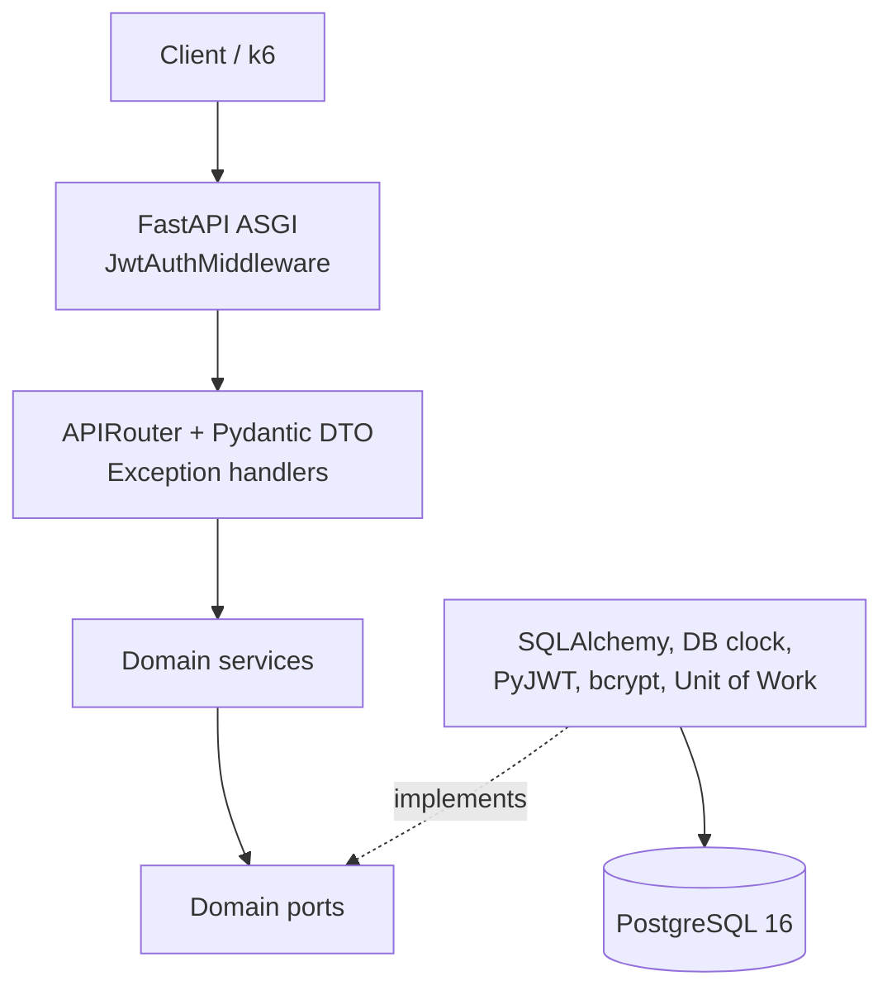
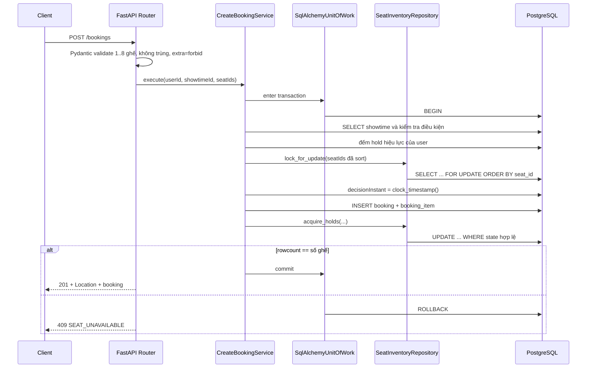

# Kiến trúc Pha 1

Tài liệu mô tả cấu trúc mã nguồn, chiều phụ thuộc, port của tầng nghiệp vụ và luồng xử lý các use case ghi dữ liệu. Đối chiếu mục 8.1 của [requirements.md](../requirements.md).

## 1. Kiến trúc



## 2. Cấu trúc package

```text
app/
├── api/
│   ├── auth/          router.py, schemas.py
│   ├── catalog/       movies.py, showtimes.py, seats.py
│   ├── booking/       bookings.py, me_bookings.py, schemas.py
│   ├── common/        pagination.py, errors.py, request_id.py
│   ├── middleware/    jwt_auth.py
│   └── dependencies.py
├── domain/
│   ├── model/         booking.py, money.py, seat.py, showtime.py
│   ├── service/       login.py, create_booking.py, confirm_booking.py,
│   │                  cancel_booking.py, view_booking.py, catalog.py
│   ├── port/          repositories.py, unit_of_work.py, clock.py,
│   │                  token_issuer.py, password_hasher.py
│   └── error/         errors.py
├── infrastructure/
│   ├── persistence/   models/, repositories/, mappers/, session.py
│   ├── time/          postgres_clock.py
│   ├── security/      jwt_token_issuer.py, bcrypt_password_hasher.py
│   └── uow.py
├── bootstrap/
│   ├── settings.py
│   ├── container.py
│   └── lifespan.py
└── main.py
alembic/
└── versions/
```

## 3. Domain service là Python thuần

Domain không dùng decorator hoặc kiểu của FastAPI, Pydantic hay SQLAlchemy. Service nhận port qua constructor và mở transaction qua Unit of Work.

```python
from collections.abc import Callable
from typing import Protocol

class UnitOfWork(Protocol):
    bookings: BookingRepository
    inventory: SeatInventoryRepository
    showtimes: ShowtimeRepository
    clock: Clock

    def __enter__(self) -> "UnitOfWork": ...
    def __exit__(self, exc_type, exc, traceback) -> None: ...
    def commit(self) -> None: ...

UnitOfWorkFactory = Callable[[], UnitOfWork]

class CreateBookingService:
    def __init__(self, uow_factory: UnitOfWorkFactory, hold_policy: HoldPolicy):
        self._uow_factory = uow_factory
        self._hold_policy = hold_policy

    def execute(self, user_id: UserId, showtime_id: ShowtimeId, seat_ids: list[SeatId]):
        with self._uow_factory() as uow:
            booking = self._create(uow, user_id, showtime_id, seat_ids)
            uow.commit()
            return booking
```

`SqlAlchemyUnitOfWork` tạo một `Session`, chia sẻ session đó cho mọi repository và `PostgresClock`, commit tường minh và rollback khi thoát mà chưa commit hoặc có exception.

Composition root ở `app.bootstrap.container` lắp ráp implementation.

## 4. Trách nhiệm từng tầng

| Tầng | Làm | Không được làm |
|---|---|---|
| `api` | Routing; Pydantic validation; lấy `user_id` từ request state; gọi service; ánh xạ domain exception thành HTTP JSON | Gọi SQLAlchemy/session trực tiếp; chứa business rule; tự xác minh JWT trong từng router |
| `domain` | Model, rule giữ ghế, vòng đời booking, quyền sở hữu, giới hạn hold; khai báo Protocol | Import FastAPI, Starlette, Pydantic, SQLAlchemy, psycopg, API hoặc infrastructure |
| `infrastructure` | Cài port bằng SQLAlchemy, SQL Core, DB clock, PyJWT, bcrypt và Unit of Work | Chứa business rule hoặc trả HTTP response |
| `bootstrap` | Đọc cấu hình, tạo engine/session factory, lắp service, đăng ký middleware/router/handler | Chứa business rule |

## 5. Ánh xạ danh tính

`JwtAuthMiddleware` là pure ASGI middleware. Nó kiểm tra route công khai, đọc Bearer token, xác minh token và đặt `user_id` vào request state.

```python
def current_user_id(request: Request) -> UserId:
    value = getattr(request.state, "user_id", None)
    if value is None:
        raise UnauthorizedError()
    return UserId(value)

@router.post("/bookings", status_code=201)
def create_booking(
    payload: CreateBookingRequest,
    user_id: Annotated[UserId, Depends(current_user_id)],
    service: Annotated[CreateBookingService, Depends(get_create_booking_service)],
) -> BookingResponse:
    return BookingResponse.from_domain(
        service.execute(user_id, payload.showtime_id, payload.seat_ids)
    )
```

Service nhận `user_id` như đối số và không biết request, header hoặc middleware tồn tại.

## 6. Các port chính

```python
class SeatInventoryRepository(Protocol):
    def lock_for_update(
        self, showtime_id: ShowtimeId, sorted_seat_ids: list[SeatId]
    ) -> list[SeatInventoryRow]: ...

    def acquire_holds(
        self,
        showtime_id: ShowtimeId,
        seat_ids: list[SeatId],
        booking_id: BookingId,
        expires_at: datetime,
        decision_instant: datetime,
    ) -> int: ...

    def mark_booked(self, booking_id: BookingId, decision_instant: datetime) -> int: ...
    def release_holds(self, booking_id: BookingId) -> int: ...

class Clock(Protocol):
    def now(self) -> datetime:
        """Đọc SELECT clock_timestamp() bằng cùng Session của Unit of Work."""
```

## 7. Luồng use case

### 7.1. Tạo booking và giữ ghế



`seatIds` phải sort tăng dần trước khi khóa. Booking được insert trước inventory update vì `showtime_seat.booking_id` tham chiếu booking.

### 7.2. Xác nhận

```text
BEGIN
  SELECT booking WHERE id=:id FOR UPDATE
  decisionInstant := SELECT clock_timestamp()
  kiểm tra quyền sở hữu và trạng thái
  CONFIRMED → trả booking cũ, không ghi thêm
  hết hạn → 409 BOOKING_EXPIRED
  UPDATE showtime_seat ... WHERE booking_id=:id AND state='HELD'
    AND hold_expires_at > :decisionInstant
  rowcount sai → rollback, 409
  UPDATE booking SET status='CONFIRMED', confirmed_at=..., booking_code=...
COMMIT
```

### 7.3. Hủy

```text
BEGIN
  SELECT booking WHERE id=:id FOR UPDATE
  decisionInstant := SELECT clock_timestamp()
  kiểm tra quyền sở hữu
  CONFIRMED → 409
  CANCELLED hoặc HELD đã hết hạn → 204 idempotent
  UPDATE showtime_seat SET AVAILABLE ... WHERE booking_id=:id AND state='HELD'
  UPDATE booking SET status='CANCELLED', cancelled_at=:decisionInstant
COMMIT
```

### 7.4. Đường đọc

Đường đọc không thu hồi hold. Trạng thái hiệu lực được suy ra trong SQL bằng `clock_timestamp()`. Bộ lọc booking dùng điều kiện trên cột thật để pagination và `totalItems` nhất quán.

## 8. Xử lý lỗi

`@app.exception_handler(...)` là nơi duy nhất đổi domain exception thành HTTP response.

| Domain exception | HTTP | `error.code` |
|---|---|---|
| `ResourceNotFoundError` | 404 | `RESOURCE_NOT_FOUND` |
| `SeatUnavailableError` | 409 | `SEAT_UNAVAILABLE` |
| `BookingExpiredError` | 409 | `BOOKING_EXPIRED` |
| `InvalidBookingStateError` | 409 | `INVALID_BOOKING_STATE` |
| `ShowtimeNotBookableError` | 409 | `SHOWTIME_NOT_BOOKABLE` |
| `HoldLimitExceededError` | 409 | `HOLD_LIMIT_EXCEEDED` |
| `DomainValidationError`, `RequestValidationError` | 400 | `VALIDATION_ERROR` |

Infrastructure bắt `sqlalchemy.exc.IntegrityError` và các lỗi psycopg có SQLSTATE đã biết như deadlock/lock conflict, rollback session rồi đổi thành domain error trước khi thoát repository hoặc Unit of Work.

## 9. Kiểm chứng ranh giới kiến trúc

File `.importlinter` chứa ít nhất:

```ini
[importlinter]
root_packages =
    app

[importlinter:contract:domain_is_independent]
name = Domain must not depend on framework or outer layers
type = forbidden
source_modules =
    app.domain
forbidden_modules =
    fastapi
    starlette
    pydantic
    sqlalchemy
    psycopg
    app.api
    app.infrastructure

[importlinter:contract:api_does_not_reach_persistence]
name = API must not import persistence implementations
type = forbidden
source_modules =
    app.api
forbidden_modules =
    app.infrastructure.persistence
```

CI chạy `uv run lint-imports`. Một vi phạm làm build fail.

## 10. Migration và startup

- Alembic revision nằm trong `alembic/versions/`.
- Trước khi start app: `uv run alembic upgrade head`.
- App không gọi `create_all`.
- Lifespan chỉ khởi tạo dependency và đóng engine khi shutdown.
- `/health/live` chỉ kiểm tra tiến trình.
- `/health/ready` kiểm tra DB và so sánh `alembic_version` với script heads.

## 11. Những gì cố tình chưa có ở Pha 1

| Không có | Lý do |
|---|---|
| Tác vụ nền thu hồi hold | Tính đúng đắn không phụ thuộc tần suất job |
| Cache | PostgreSQL là nguồn quyết định; cache là ứng viên Pha 2 |
| Idempotency key cho `POST /bookings` | Client không được retry mù |
| Refresh/revoke token | Ngoài phạm vi |
| Rate limit login | Ngoài phạm vi Pha 1 |
