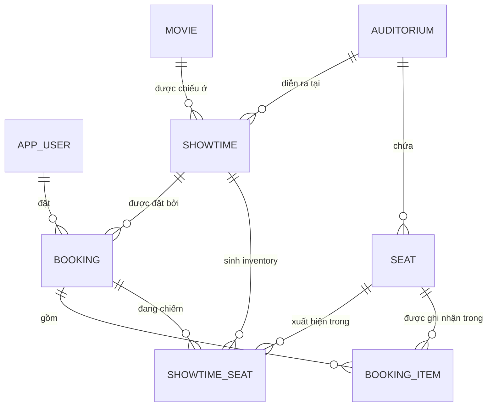

# Mô hình dữ liệu

Thiết kế schema, ràng buộc, index và chiến lược seed. Đối chiếu mục 7 của [requirements.md](../requirements.md).

## 1. Sơ đồ quan hệ



Hai bảng cùng nối `booking` với `seat` và điều đó là có chủ đích:

| Bảng | Vai trò | Vòng đời |
|---|---|---|
| `booking_item` | **Lịch sử.** Ghi lại booking này từng gồm những ghế nào, giá bao nhiêu | Không bao giờ bị xóa hay sửa, kể cả khi booking bị hủy |
| `showtime_seat` | **Inventory.** Ai đang chiếm ghế này ở suất chiếu này, ngay lúc này | Bị ghi đè liên tục; một dòng cho mỗi cặp `(showtime_id, seat_id)` |

Đây là lý do đặc tả cấm đặt unique trên `booking_item(showtime_id, seat_id)` cho toàn bộ lịch sử: ghế phải đặt lại được sau khi hủy hoặc hết hạn.

## 2. Khóa chính và ID đối ngoại

Khóa chính nội bộ là `BIGINT GENERATED ALWAYS AS IDENTITY`. API trả ID dưới dạng **chuỗi thập phân** của giá trị đó và dùng nhất quán ở mọi endpoint, đúng quy ước "ID là chuỗi định danh opaque" ở mục 6.1.

Lý do chọn `BIGINT` thay vì `UUID`:

- Index nhỏ hơn và cục bộ hơn, quan trọng với `showtime_seat` — bảng nóng nhất và là bảng có số dòng lớn nhất.
- Không phân mảnh B-tree như UUIDv4 ngẫu nhiên, nên ít ảnh hưởng tới số liệu baseline ở mục 10.
- ID có thể đoán được không phải vấn đề bảo mật ở đây: mọi endpoint đọc booking đều kiểm tra quyền sở hữu và trả `404` khi không phải chủ (FR-09), nên việc đoán ID không lộ dữ liệu.

Mã đối ngoại duy nhất **không** suy ra được từ ID là `booking_code`, sinh khi xác nhận thành công.

## 3. DDL và Alembic

Schema được quản lý bằng Alembic trong thư mục `alembic/versions/`. Revision đầu tiên có tên mô tả như `20261014_0001_baseline_schema.py`; các revision sau khai báo đúng `down_revision`.

Quy tắc bắt buộc:

- Chạy `uv run alembic upgrade head` trước khi khởi động ứng dụng.
- Không gọi `Base.metadata.create_all()` trong startup, test integration hoặc production.
- DDL đặc thù PostgreSQL được thực hiện bằng `op.execute(...)` hoặc SQLAlchemy DDL trong hàm `upgrade()`.
- Hàm `downgrade()` chỉ được dùng cho môi trường phát triển; production ưu tiên revision sửa lỗi tiến về phía trước.
- CI chạy migration từ database trống, kiểm tra `alembic current` khớp `alembic heads`, sau đó chạy `uv run alembic check`.
- Seed là lệnh riêng `uv run python -m app.scripts.seed`, không nằm trong migration.

```sql
-- Nội dung tương đương revision 20261014_0001_baseline_schema.py

CREATE TABLE app_user (
    id            BIGINT GENERATED ALWAYS AS IDENTITY PRIMARY KEY,
    email         VARCHAR(320) NOT NULL,
    password_hash VARCHAR(100) NOT NULL,
    created_at    TIMESTAMPTZ  NOT NULL DEFAULT clock_timestamp(),
    CONSTRAINT uq_app_user_email UNIQUE (email)
);
-- email được chuẩn hóa (trim + lower) TRƯỚC khi ghi, ở cả seed lẫn đăng nhập (FR-01).

CREATE TABLE movie (
    id               BIGINT GENERATED ALWAYS AS IDENTITY PRIMARY KEY,
    title            VARCHAR(255) NOT NULL,
    description      TEXT         NOT NULL DEFAULT '',
    duration_minutes INTEGER      NOT NULL,
    CONSTRAINT ck_movie_duration CHECK (duration_minutes > 0)
);

CREATE TABLE auditorium (
    id   BIGINT GENERATED ALWAYS AS IDENTITY PRIMARY KEY,
    name VARCHAR(100) NOT NULL,
    CONSTRAINT uq_auditorium_name UNIQUE (name)
);

CREATE TABLE seat (
    id             BIGINT GENERATED ALWAYS AS IDENTITY PRIMARY KEY,
    auditorium_id  BIGINT      NOT NULL REFERENCES auditorium(id) ON DELETE RESTRICT,
    row_label      VARCHAR(4)  NOT NULL,
    seat_number    SMALLINT    NOT NULL,
    CONSTRAINT uq_seat_position UNIQUE (auditorium_id, row_label, seat_number),
    CONSTRAINT ck_seat_number CHECK (seat_number > 0)
);

CREATE TABLE showtime (
    id                  BIGINT GENERATED ALWAYS AS IDENTITY PRIMARY KEY,
    movie_id            BIGINT      NOT NULL REFERENCES movie(id)      ON DELETE RESTRICT,
    auditorium_id       BIGINT      NOT NULL REFERENCES auditorium(id) ON DELETE RESTRICT,
    starts_at           TIMESTAMPTZ NOT NULL,
    ends_at             TIMESTAMPTZ NOT NULL,
    ticket_price        BIGINT      NOT NULL,
    is_open_for_booking BOOLEAN     NOT NULL DEFAULT TRUE,
    CONSTRAINT ck_showtime_window CHECK (ends_at > starts_at),
    CONSTRAINT ck_showtime_price  CHECK (ticket_price >= 0)
);

CREATE TABLE booking (
    id           BIGINT GENERATED ALWAYS AS IDENTITY PRIMARY KEY,
    user_id      BIGINT      NOT NULL REFERENCES app_user(id) ON DELETE RESTRICT,
    showtime_id  BIGINT      NOT NULL REFERENCES showtime(id) ON DELETE RESTRICT,
    status       VARCHAR(16) NOT NULL,
    created_at   TIMESTAMPTZ NOT NULL,
    expires_at   TIMESTAMPTZ NOT NULL,
    confirmed_at TIMESTAMPTZ NULL,
    cancelled_at TIMESTAMPTZ NULL,
    total_amount BIGINT      NOT NULL,
    booking_code VARCHAR(16) NULL,
    CONSTRAINT ck_booking_status CHECK (status IN ('HELD','CONFIRMED','CANCELLED','EXPIRED')),
    CONSTRAINT ck_booking_total  CHECK (total_amount >= 0),
    CONSTRAINT uq_booking_code   UNIQUE (booking_code),
    CONSTRAINT ck_booking_confirmed CHECK (
        (status = 'CONFIRMED' AND confirmed_at IS NOT NULL AND booking_code IS NOT NULL)
        OR (status <> 'CONFIRMED' AND confirmed_at IS NULL AND booking_code IS NULL)),
    CONSTRAINT ck_booking_cancelled CHECK (
        (status = 'CANCELLED') = (cancelled_at IS NOT NULL))
);

CREATE TABLE booking_item (
    id         BIGINT GENERATED ALWAYS AS IDENTITY PRIMARY KEY,
    booking_id BIGINT NOT NULL REFERENCES booking(id) ON DELETE RESTRICT,
    seat_id    BIGINT NOT NULL REFERENCES seat(id)    ON DELETE RESTRICT,
    unit_price BIGINT NOT NULL,
    CONSTRAINT uq_booking_item UNIQUE (booking_id, seat_id),
    CONSTRAINT ck_booking_item_price CHECK (unit_price >= 0)
);

CREATE TABLE showtime_seat (
    showtime_id     BIGINT      NOT NULL REFERENCES showtime(id) ON DELETE RESTRICT,
    seat_id         BIGINT      NOT NULL REFERENCES seat(id)     ON DELETE RESTRICT,
    state           VARCHAR(12) NOT NULL DEFAULT 'AVAILABLE',
    booking_id      BIGINT      NULL REFERENCES booking(id) ON DELETE RESTRICT,
    hold_expires_at TIMESTAMPTZ NULL,
    PRIMARY KEY (showtime_id, seat_id),
    CONSTRAINT ck_showtime_seat_state CHECK (
        (state = 'AVAILABLE' AND booking_id IS NULL     AND hold_expires_at IS NULL)
     OR (state = 'HELD'      AND booking_id IS NOT NULL AND hold_expires_at IS NOT NULL)
     OR (state = 'BOOKED'    AND booking_id IS NOT NULL AND hold_expires_at IS NULL))
);
```

### Vì sao BR-01 được bảo đảm bằng cấu trúc

`PRIMARY KEY (showtime_id, seat_id)` nghĩa là mỗi cặp suất chiếu–ghế chỉ tồn tại **đúng một dòng**. Một dòng chỉ mang được một `booking_id`. Vì vậy "một ghế trong một suất chiếu chỉ có tối đa một quyền chiếm chỗ có hiệu lực" là hệ quả của schema, không phải của logic ứng dụng. Không có đường nào để hai booking cùng chiếm một ghế mà không vi phạm khóa chính.

`ck_showtime_seat_state` khóa chặt các tổ hợp vô nghĩa, ví dụ `BOOKED` mà không có booking, hay `HELD` mà không có hạn.

### Vì sao các bản ghi inventory phải tạo sẵn

Toàn bộ dòng `showtime_seat` được tạo **trong cùng transaction với việc tạo suất chiếu**, ở seed hoặc migration:

```sql
INSERT INTO showtime_seat (showtime_id, seat_id)
SELECT :showtimeId, s.id FROM seat s WHERE s.auditorium_id = :auditoriumId;
```

Nếu tạo dòng theo kiểu lazy ở đường ghi, hai transaction cùng thấy "chưa có dòng" và cùng `INSERT` sẽ tái tạo đúng race mà BR-04 muốn loại bỏ; kết quả là một bên nhận lỗi vi phạm khóa chính, tức là một `500` cho một tình huống tranh chấp hoàn toàn hợp lệ. Tạo sẵn biến toàn bộ đường cấp ghế thành `UPDATE` thuần trên dòng đã tồn tại.

Khối lượng: 3 phòng × 100 ghế × 60 suất = **18.000 dòng** cho profile seed ở mục 10.3. Không đáng kể.

## 4. Index

```sql
-- Đường ghi: khóa và cập nhật inventory theo booking (BR-08)
CREATE INDEX ix_showtime_seat_booking   ON showtime_seat (booking_id)
    WHERE booking_id IS NOT NULL;

-- Đường đọc sơ đồ ghế (L-02): PK (showtime_id, seat_id) đã đủ cho lọc theo suất

-- FR-09: danh sách booking cá nhân, sắp xếp mới nhất trước
CREATE INDEX ix_booking_user_created    ON booking (user_id, created_at DESC, id DESC);

-- FR-09: lọc theo trạng thái hiệu lực, và đếm hold đang hiệu lực cho BR-11
CREATE INDEX ix_booking_user_status_exp ON booking (user_id, status, expires_at);
CREATE INDEX ix_booking_showtime_user   ON booking (showtime_id, user_id, status);

-- FR-03: lọc suất chiếu theo phim và ngày, thứ tự ổn định theo (starts_at, id)
CREATE INDEX ix_showtime_movie_starts   ON showtime (movie_id, starts_at, id);
CREATE INDEX ix_showtime_starts         ON showtime (starts_at, id);

-- FR-04: liệt kê ghế theo phòng, thứ tự ổn định
CREATE INDEX ix_seat_auditorium_pos     ON seat (auditorium_id, row_label, seat_number);
```

Không thêm index nào khác trước khi có số liệu. Thêm index dựa trên phỏng đoán làm nhiễu so sánh baseline ở mục 10, và mục 11.2 đã cảnh báo rằng chỉ thêm index không được tính là cải tiến kiến trúc.

## 5. Truy vấn của đường ghi

### Cấp quyền giữ ghế

```sql
-- bước 1: khóa theo thứ tự xác định để tránh deadkock giữa hai tập ghế giao nhau
SELECT showtime_id, seat_id, state, booking_id, hold_expires_at
  FROM showtime_seat
 WHERE showtime_id = :showtimeId AND seat_id = ANY(:seatIds)
 ORDER BY seat_id
   FOR UPDATE;

-- bước 2: ghi có điều kiện; result.rowcount là câu trả lời cuối cùng
UPDATE showtime_seat
   SET state = 'HELD', booking_id = :bookingId, hold_expires_at = :expiresAt
 WHERE showtime_id = :showtimeId
   AND seat_id = ANY(:seatIds)
   AND (state = 'AVAILABLE'
        OR (state = 'HELD' AND hold_expires_at <= :decisionInstant));
```

Bước 2 vẫn cần thiết dù bước 1 đã khóa dòng: nó là ràng buộc cuối cùng chạy trong DB, độc lập với mọi giả định của ứng dụng, và là thứ bảo đảm rằng "kiểm tra rồi ghi" không bao giờ là cơ sở duy nhất (BR-04). Mệnh đề `hold_expires_at <= :decisionInstant` đồng thời là toàn bộ cơ chế thu hồi hold hết hạn của Pha 1.

### Xác nhận và hủy

```sql
-- xác nhận: chỉ chạm các dòng đang thuộc đúng booking này và hold còn hạn
UPDATE showtime_seat SET state = 'BOOKED', hold_expires_at = NULL
 WHERE booking_id = :bookingId AND state = 'HELD' AND hold_expires_at > :decisionInstant;

-- hủy: chỉ chạm các dòng đang thuộc đúng booking này
UPDATE showtime_seat SET state = 'AVAILABLE', booking_id = NULL, hold_expires_at = NULL
 WHERE booking_id = :bookingId AND state = 'HELD';
```

Điều kiện `booking_id = :bookingId` là cơ chế thực thi BR-08. Nếu hold đã hết hạn và ghế đã bị booking khác giành lấy, `booking_id` trên dòng đó đã đổi, nên lệnh đến muộn không khớp dòng nào và không thể giải phóng quyền giữ mới.

### Đếm hold đang hiệu lực (BR-11)

```sql
SELECT count(*) FILTER (WHERE showtime_id = :showtimeId) AS per_showtime,
       count(*)                                          AS total
  FROM booking
 WHERE user_id = :userId AND status = 'HELD' AND expires_at > :decisionInstant;
```

## 6. Bất biến phải luôn đúng

Các câu truy vấn dưới đây phải trả về **0 dòng** sau mọi bài kiểm thử tranh chấp và mọi lần đo tải (`NFR-01`, mục 10.5 bước 7). Chúng được đóng gói thành script `scripts/check-invariants.sql`.

```sql
-- I1. Không có ghế nào bị hai booking hiệu lực cùng chiếm.
--     Không thể xảy ra theo schema; truy vấn này canh chừng việc schema bị đổi.
SELECT showtime_id, seat_id, count(*) FROM showtime_seat
 GROUP BY showtime_id, seat_id HAVING count(*) > 1;

-- I2. Inventory BOOKED phải trỏ tới một booking CONFIRMED.
SELECT ss.* FROM showtime_seat ss JOIN booking b ON b.id = ss.booking_id
 WHERE ss.state = 'BOOKED' AND b.status <> 'CONFIRMED';

-- I3. Mọi booking CONFIRMED phải chiếm đúng số ghế bằng số item của nó.
SELECT b.id FROM booking b
 WHERE b.status = 'CONFIRMED'
   AND (SELECT count(*) FROM showtime_seat ss
         WHERE ss.booking_id = b.id AND ss.state = 'BOOKED')
    <> (SELECT count(*) FROM booking_item bi WHERE bi.booking_id = b.id);

-- I4. Booking CANCELLED không được còn chiếm ghế nào.
SELECT ss.* FROM showtime_seat ss JOIN booking b ON b.id = ss.booking_id
 WHERE b.status = 'CANCELLED';

-- I5. Tổng tiền phải khớp tổng item (BR-06).
SELECT b.id FROM booking b
 WHERE b.total_amount <> (SELECT COALESCE(sum(bi.unit_price), 0)
                            FROM booking_item bi WHERE bi.booking_id = b.id);

-- I6. Không có booking nào bị ghi một phần: đã có booking thì phải có item.
SELECT b.id FROM booking b
 WHERE NOT EXISTS (SELECT 1 FROM booking_item bi WHERE bi.booking_id = b.id);

-- I7. Mọi cặp (suất chiếu, ghế của phòng tương ứng) đều có dòng inventory.
SELECT st.id, s.id FROM showtime st
  JOIN seat s ON s.auditorium_id = st.auditorium_id
 WHERE NOT EXISTS (SELECT 1 FROM showtime_seat ss
                    WHERE ss.showtime_id = st.id AND ss.seat_id = s.id);
```

## 7. Seed

Theo mục 10.3 của đặc tả. Xác định hoàn toàn bởi `SEED_RANDOM_SEED`, nên cùng commit và cùng seed cho ra cùng dữ liệu (`NFR-08`).

| Thực thể | Số lượng | Ghi chú |
|---|---|---|
| `movie` | 10 | Thời lượng 90–150 phút |
| `auditorium` | 3 | |
| `seat` | 3 × 100 | Hàng `A`–`J`, mỗi hàng 10 ghế |
| `showtime` | 60 | 20 suất cho mỗi phòng |
| `app_user` | 200 | `user001@example.test` … `user200@example.test`, cùng mật khẩu demo |
| `showtime_seat` | 6.000 | Sinh tự động cùng suất chiếu |

Quy tắc bắt buộc:

- `starts_at` sinh **tương đối so với thời điểm chạy seed**, không phải ngày cố định, để không vô tình tạo suất đã hết giờ. Giữ nguyên khoảng cách tương đối giữa các lần đo.
- `ends_at = starts_at + duration_minutes + 15 phút dọn phòng`.
- Không có hai suất chồng lấn trong cùng một phòng. Seed phải tự kiểm tra điều này và fail nếu vi phạm.
- Chỉ hash mật khẩu demo **một lần** rồi tái sử dụng cho cả 200 tài khoản. BCrypt cố tình chậm; hash 200 lần làm thời gian seed tăng lên hàng chục giây và ảnh hưởng tới ngân sách phiên Kaggle (RI-01).

### Profile dữ liệu

| Profile | Mô tả | Dùng cho |
|---|---|---|
| `empty-seats` | Toàn bộ ghế `AVAILABLE` | L-03, L-04, L-06 |
| `mixed` | 20% ghế `BOOKED`, 10% ghế `HELD` với hạn còn hiệu lực tính từ lúc seed | L-01, L-02, L-05 |

Mỗi bài đo phải ghi rõ profile đã dùng; cột `Profile dữ liệu` trong bảng kết quả ở mục 10.7 tồn tại vì lý do này.

## 8. Ánh xạ SQLAlchemy

SQLAlchemy models nằm trong `app.infrastructure.persistence.models` và **không** rò rỉ khỏi tầng `infrastructure`. Repository trả domain model; mapper trong `app.infrastructure.persistence.mappers` chịu trách nhiệm chuyển đổi.

Bốn quy tắc:

1. **Inventory dùng SQLAlchemy Core hoặc `text()` với câu SQL tường minh.** `select(...).with_for_update()` khóa theo `seat_id`; `update(...).where(...)` thực hiện ghi có điều kiện; `result.rowcount` là kết quả quyết định.
2. **Không dựa vào ORM state tracking cho `showtime_seat`.** Sau bulk update, gọi `Session.expire_all()` khi transaction còn cần đọc lại entity, hoặc không giữ ORM instance của inventory trong identity map.
3. **Không thêm version column cho `showtime_seat`.** Optimistic locking biến tranh chấp bình thường thành exception cần retry, trong khi điều kiện `WHERE` và `rowcount` đã cho kết quả `409` xác định.
4. **Không cấu hình cascade từ booking sang `showtime_seat`.** Inventory có vòng đời theo showtime, không phải theo booking. Quan hệ ORM nếu có phải dùng `passive_deletes` và hành vi xóa đúng với khóa ngoại trong schema.

`Session` được tạo bởi `SqlAlchemyUnitOfWork`, dùng `expire_on_commit=False`, không được chia sẻ giữa request hoặc thread. Mỗi use case ghi dùng đúng một Session và một transaction.
